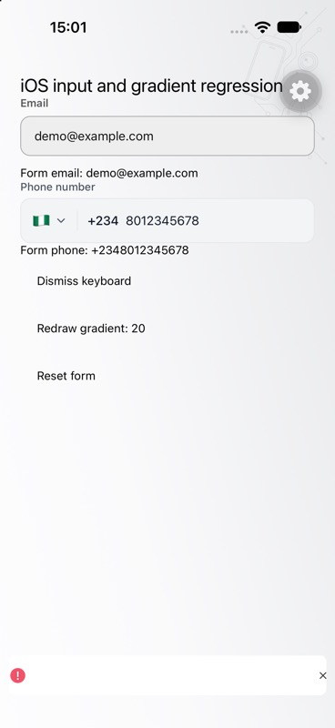

# iOS keyboard and gradient hangs — 13 October 2026

## Evidence and boundaries

Investigated in the isolated `codex/ios-keyboard-render-hangs` worktree from main
`3804086a22800d7c0aca0956e6394b06c92fc169`. The primary checkout's unrelated edits
were preserved. Sentry events were read through the existing private VPS worker
credentials; no credentials or customer input were retained.

- [BACI-MOBILE-STOREFRONT-45](https://ogabassey-services-limited.sentry.io/issues/153139900/),
  event `0dfe9ecda6fa43eca0799c39826be0f7`: React Native attributed-text update enters
  UIKit autofill and blocks on its keyboard task queue for 5.0–5.8 seconds.
  Breadcrumbs include checkout, Credit Direct, cancellation, a product screen and
  a later cart removal alert. The sampled stack does not identify the text field.
- [BACI-MOBILE-STOREFRONT-3A](https://ogabassey-services-limited.sentry.io/issues/146307054/),
  event `681447da9f124cdda223a150798538e2`: `LinearGradientLayer.display`,
  `setLayerContents` and `CGContextDrawLinearGradient` occupy the main thread for
  3.5–4.3 seconds. The installed Expo 57.0.1 implementation still synchronously
  allocates and shades a bitmap at display scale for the whole layer bounds.
- [BACI-MOBILE-STOREFRONT-2T](https://ogabassey-services-limited.sentry.io/issues/143807900/),
  event `2056de45321240e8b4a417ea2b650fee`: WebKit's `elementDidFocus` enters UIKit
  keyboard layout. This approximately 79-second hang occurs in the hosted Credit
  Direct flow. Its stack contains no React Native input or keyboard-preload frame.
  The app-field changes below do not establish a fix for this separate case.
- The watchdog event in group 2N has no stack establishing its termination cause.
  It is not a confirmed out-of-memory diagnosis or a verified fix in this task.

These retained events occurred on 12 October in iOS release
`com.ogabassey.app@2.1.559+559`. The keyboard/gradient samples have serious thermal
state and low free memory on iPhone10,6/iOS 16.7.16. Those conditions are context,
not proof of cause. Release 559 lacks attached source-commit provenance; the
current checkout must not be represented as its exact shipped dependency tree.

## Changes

1. Checkout email and phone inputs previously changed the native edit immediately
   when removing whitespace, separators or a phone prefix. Their controlled
   `value` therefore differed from the autofill event while UIKit still owned the
   keyboard. `useNativeInputDraft` now echoes the original native edit until blur
   while the form immediately receives the same normalized email/phone data as
   before. External value changes replace the draft, and stale drafts cannot
   reappear when the form returns to an earlier value. Autofill remains enabled.
2. Phone limits apply to normalized digits, allowing formatted numbers to contain
   separators without prematurely exhausting the native character limit. Country
   selection clears the draft, and the caller's blur callback remains intact.
3. A version-pinned pnpm patch makes Expo's gradient layer a `CAGradientLayer`.
   It removes application bitmap allocation/shading from the display path while
   retaining colors, normalized endpoints, partial/custom/default locations,
   dynamic-color refresh, presentation-layer copies and immediate prop updates.
   It applies to both mobile consumers; Android's renderer is unchanged. Storefront
   already disables Expo precompiled modules so release prebuild compiles the
   patched source. This requires a new native iOS build, not an OTA-only update.

The text changes eliminate a confirmed active-field rewrite in app code. They
reduce a trigger matching the UIKit sample; unit tests cannot prove that every
OS keyboard deadlock, including the hosted WebKit case, is eliminated.

## Verification

- Email regressions failed before the fix (3 assertions) and phone autofill
  preservation failed before its fix (1 assertion). The phone-limit review fix
  also had two failing regressions before correction, including simulated native
  typing with a formatted US number.
- Final targeted checkout/form/phone run: 3 suites, 29 tests passed. It covers
  canonical form data during editing, raw native text, blur settlement, deletion,
  external resets, repeated normalized values, formatted non-Nigerian input and
  digit caps.
- Full storefront suite: 1,440 suites, 8,577 tests passed.
- Full monorepo lint/typecheck: 10 tasks passed. Final affected-app lint/typecheck
  after the phone-limit change: 2 tasks passed. Existing lint warnings remain.
- Platform drift: passed, no new platform branches or forbidden patterns.
- `bash apps/mobile-storefront/scripts/native-regressions/check-gradient-layer.sh`:
  compiles and executes the installed production layer against macOS QuartzCore,
  replacing only Expo's platform import with the corresponding native color type.
  The unpatched layer fails the composition assertion. The patched layer passes
  composition, absence of an application-assigned CGImage, stop positions,
  defaults, color-count changes, presentation copies and clearing. The same
  installed source also passes UIKit typechecking for arm64 iOS Simulator with
  deployment target 16.4.
- Diagnostic host benchmark at 375×1500 points, 20 changed-color displays:
  unpatched 537.7 ms, patched 26.2 ms. This is a host comparison, not a production
  iPhone latency measurement or an enforced timing threshold.
- CodeRabbit initial review raised one valid minor phone-limit issue; corrected
  with regressions. Final staged/uncommitted review completed with 0 issues and
  included all 12 changed code/config/test files, including the native patch.

- Full monorepo tests: 5 of 6 package tasks passed. Web had 7,666 passing files,
  3 failing files and 57 skipped files (49,056 passing tests). Two failures are
  intentional checkout-integrity safeguards: the current lockfile differs from
  uncommitted HEAD, and the tooling worktree contains uncommitted changes.
  These tests require a clean committed checkout. The third failure was a
  10-second timeout in a synthetic large Git inventory; its isolated rerun
  passed all 8 tests in 4.7 seconds. No safeguard was weakened. After restoring the temporary native QA files and
  committing the fixes as `376b4a8103`, both Git-integrity test files passed
  (2 tests, 20.1 seconds) from a clean checkout. All three initial failures
  therefore passed their scoped reruns; the complete 30-minute monorepo suite
  was not rerun.

## Simulator component checks

The full Debug app built successfully against Xcode 27 after an incremental retry.
The first cold build's ExpoModulesJSI packaging script emitted error diagnostics
while still producing its framework; the retry succeeded in 127 seconds. The
patched gradient compiled as part of the real Expo module.

The available simulator is iPhone 18 Pro / iOS 27.0. The current Expo template
fails before React loads because it lacks the scene lifecycle required for apps
built against SDK 27. [Apple documents this requirement](https://developer.apple.com/documentation/uikit/transitioning-to-the-uikit-scene-based-life-cycle).
For local component QA only, a temporary scene adapter connected the existing
window. Expo's development-launcher loading cover also remained above the React
screen; LLDB identified and removed that temporary cover. Neither workaround is
part of the fix. This is not a passing production launch or end-to-end checkout
test with Xcode 27; that compatibility work remains separate.

Using the real CheckoutFormField, PhoneInput, AppKeyboardProvider and a 1,500-point
GadgetPattern in a temporary entry point, runtime assertions verified:

- Email retains an internal space while the form stores `demo@example.com`; blur
  removes the space from the displayed native field.
- `0801 234 5678` and `+234 801 234 5678` remain formatted during editing and both
  immediately store `+2348012345678`; blur shows the national digits.
- An external reset while the phone field is focused clears both canonical form
  values and native edits.
- Twenty redraw button actions completed while the keyboard was active. LLDB's
  native hierarchy showed the counter at 20 and the patched gradient layer at
  402 by 1,500 points; the screenshot showed the composed gradient and inputs.

The initial cold keyboard automation delivered a partial email; a repeat after
keyboard initialization delivered all characters. This does not establish
physical-device/autofill behavior under thermal pressure. No provider payment or
customer account was used. Temporary entry/package/native files were restored.

No iOS release has been published and no Sentry issue has been marked resolved. A representative physical iOS 16.7 device and a hosted
provider test session are still needed to verify the original OS/WebKit hangs.

## iOS 27 launch follow-up — 14 October 2026

The follow-up fixes the separate scene-lifecycle launch failure above using
[Expo's supported SDK 57 opt-in](https://github.com/expo/expo/issues/46664).
Expo 57.0.23 and expo-build-properties 57.0.20 supply the scene runtime and
`ios.enableSceneSupport`. The checked-in AppDelegate now provides its React
factory without creating the window; the scene manifest points at
`EXExpoAppSceneDelegate`. Existing URL/universal-link callbacks are preserved.
Expo and its dev client remain aligned across linked mobile packages.

The new ExpoModulesJSI 57.1.2 has upstream retained factories, replacing the old
constructor patch. The existing EventEmitter concurrency patch is carried onto
ExpoModulesCore 57.0.21 for the Xcode 26 release runner. The Swift probe always
compiles both real factories; its negative ownership probe applies only to
Swift 6.4 and newer, which introduced that diagnostic. CodeRabbit identified
and verified correction of this toolchain distinction; final review of all
20 staged files completed with 0 issues.

Exact dependency exceptions preserve the workspace's trust policy. Release
identity was checked against expo/expo, and available source files were checked
against those Git blob hashes. Compiled-only CLI packages have release-identity
verification, not a claim that their compiled output was independently rebuilt.
[Dependency evidence](expo-scene-dependencies.json) records the scope. Frozen
pnpm installation passed. Native prebuild generated the scene manifest and
factory-provider conformance without a custom scene delegate.

- Xcode 27 built and launched the real Debug storefront on iPhone 18 Pro /
  iOS 27.0. The first build exceeded the tool's 300-second response window while
  compilation continued. An early retry encountered its database lock; after
  the original build completed, the incremental build/install/launch passed.
- The ordinary storefront rendered its real catalog after loading its own Metro
  server. No LLDB overlay removal or temporary scene adapter was used.
- A warm `ogabassey://auth/login` link displayed the login screen. Cold native
  startup succeeded, but a cold ordinary app link in the development client
  opened its server picker; this is not verification of a bundled Release
  build's cold authentication link.
- Simulator input automation inconsistently opened Expo developer tools instead
  of typing into the selected field. Permission prompts and the developer-menu
  intro were dismissed through normal UI actions. This follow-up does not claim
  a passing end-to-end keyboard/autofill test; the earlier component checks and
  deterministic input regressions remain the relevant keyboard evidence.
- Updated config/native-peer/JSI regressions passed: 3 suites / 11 tests.
  Checkout/phone regressions passed again: 3 suites / 29 tests. Scene contracts,
  retained-factory compilation and EventEmitter contracts passed: 7 tests.
  The installed gradient composition probe also passed again.
- The initial parallel monorepo run was interrupted after the admin package
  failed. Its outdated JSI version guard was updated to the upstream factory
  release; all three failed admin files then passed (12 tests). The storefront
  savings timeout passed on rerun. Local prebuild removed the checked-in Facebook
  build phase; unrelated generated project changes were restored and all ten
  native ad-config checks passed. Full package checks continue before shipment.
- Metro-generated route declarations exposed seven existing type errors in hero
  fixtures and wallet return-link plumbing. Those source files are unchanged by
  this fix; generated-route checking is distinct from the standard clean-checkout
  repository typecheck. This task does not claim those declarations are clean.

A native release is required. The PR, exact-head CI/review, App Store Connect
upload and Apple approval are separate delivery stages; this section records
local evidence before those stages.

Review follow-up: gradient integrity now runs in the storefront Node test suite,
and the actual native composition probe runs in the macOS PR and release gates.
Direct hook tests cover raw draft retention, external resets, stale draft removal
and blur settlement. Admin dependencies are aligned, but its scene migration is
outside this storefront release: `.github/workflows/ios-release.yml` remains
pinned to Xcode 26.2; admin launch on the iOS 27 SDK is not claimed supported.

Codex identified the SDK 57 presentation backport gap documented in Expo #50363.
The installed core, WebBrowser, Apple Authentication and Print sources still
read the deprecated application key window after opting into scenes. Seven
new source regressions failed before the fix. Minimal native patches now use
the existing SceneGeometry lookup (Expo #48319 and #50368), including both
browser/auth anchors and both printer presenters. The shared core helper also
preserves macOS behavior. ImagePicker receives the fix through its existing
currentViewController consumer.

The complete local monorepo run finished: admin 913 files / 4,494 tests,
storefront 1,440 suites / 8,577 tests, shared 227 files / 1,553 tests,
TikTok 3 files / 9 tests and the qualification worker 10 tests passed.
Web passed 7,668 files / 49,058 tests with one failure: its private isolation
fixture requires a clean Git checkout and ran while native files were changing.
That exact file passed after the files were committed. The aggregate command
therefore exited nonzero; this is reported separately from the successful rerun.
After the presentation patches, all 10 lint/typecheck tasks passed again,
32 input tests and 59 native/config contracts passed, and frozen installation
succeeded. The patched native app rebuilt, installed and launched on the iOS 27
simulator without compiler errors. Current-head GitHub checks/review and the
production archive remain release gates; successful sheet authentication or
provider payment is not claimed by compilation and launch alone.
