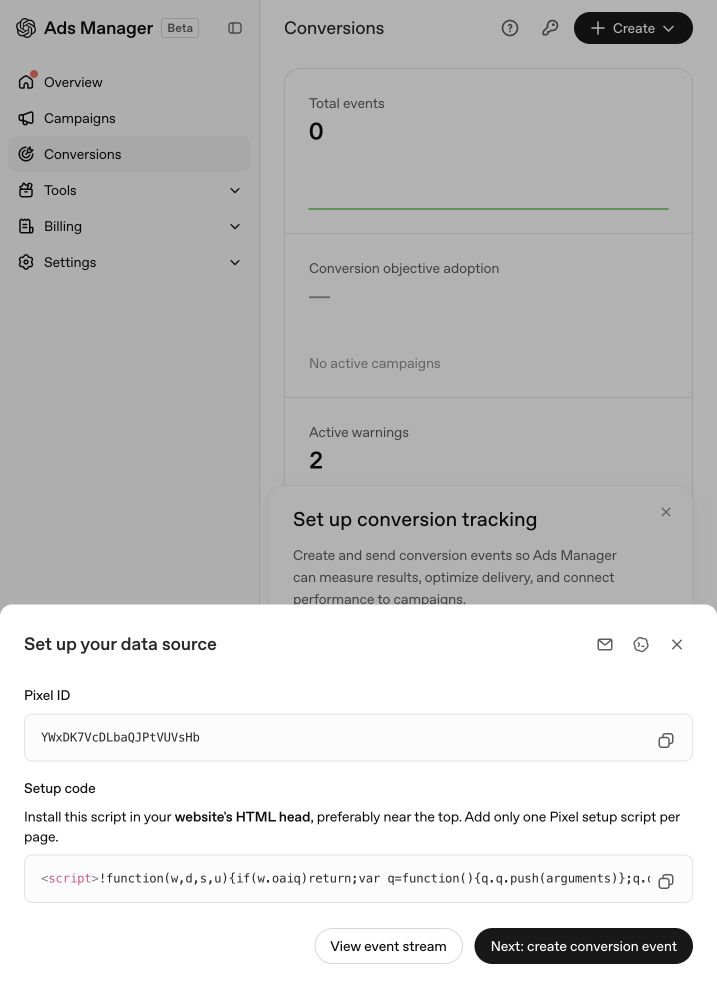
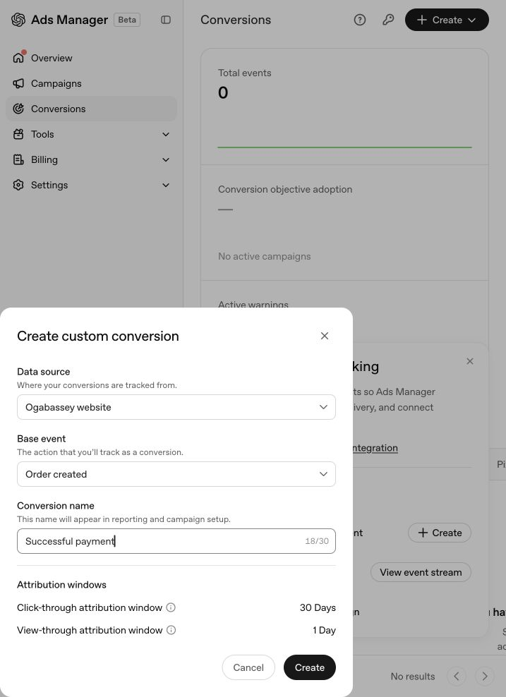
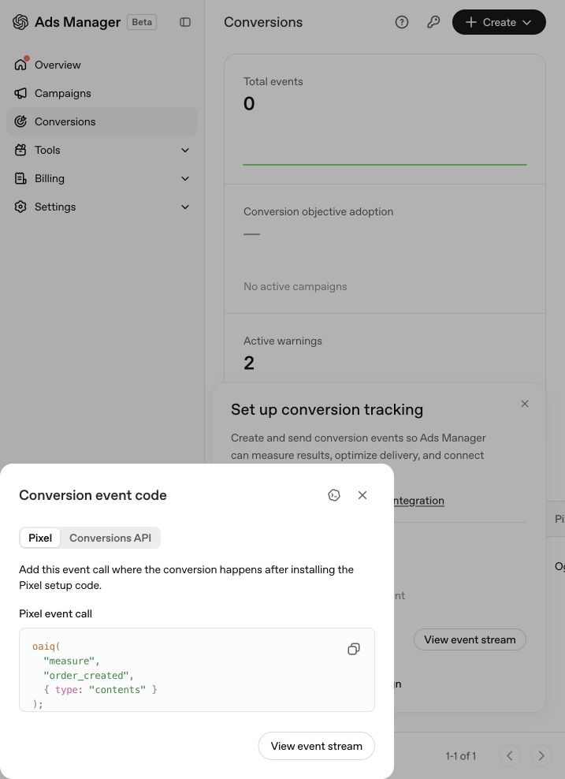
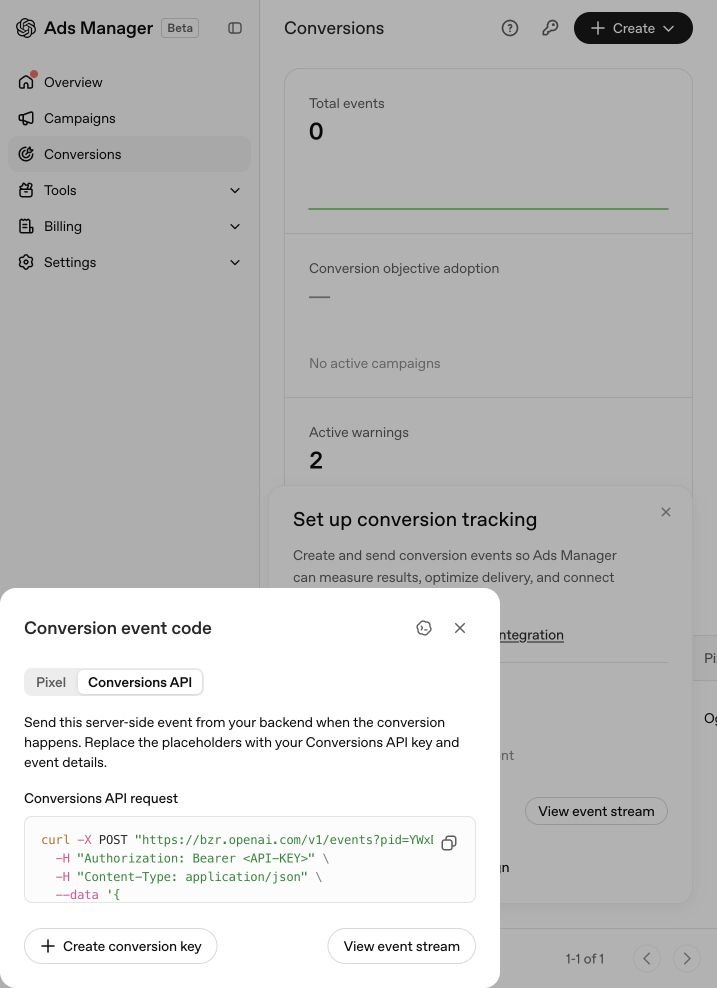
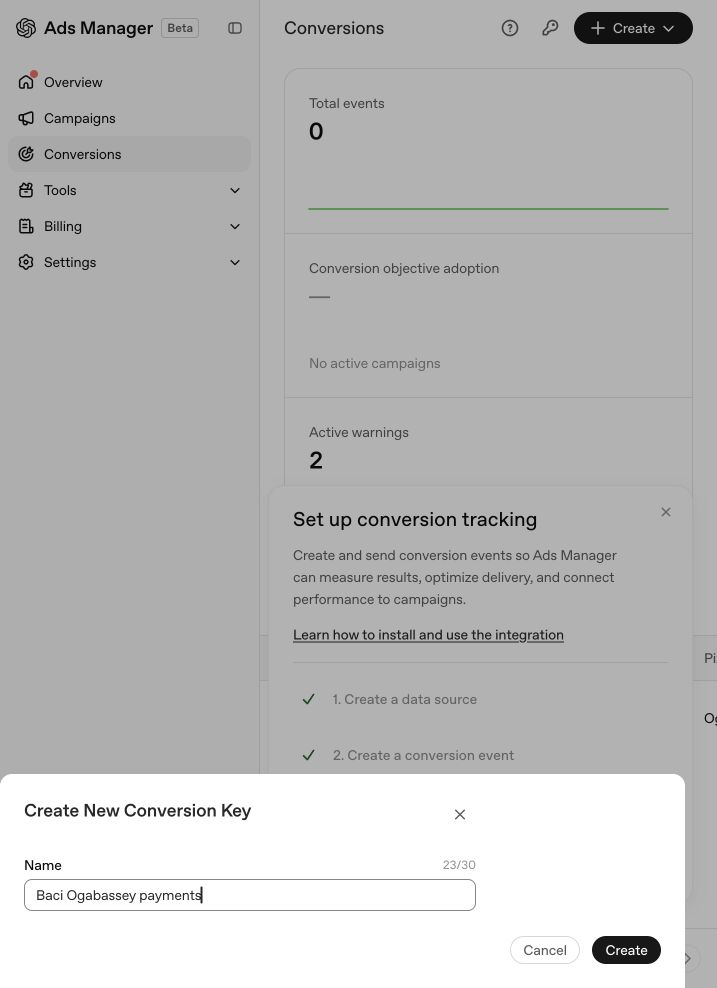

# Set up ChatGPT Ads measurement

Captured from Ads Manager on 24 October 2026. These screenshots show Ogabassey's
account as an example. Each merchant must use their own account, Pixel ID, and
server conversion key. The screenshots contain no API keys.

## 1. Create a website data source

In Ads Manager, open **Conversions → Data Source → Create data source**. Give it
your store's name, review the Conversion Terms, and create it. Copy the Pixel ID
from the setup screen. A Pixel ID is a public identifier; it is not a CAPI key.

## 2. Define the paid conversion

Choose **Next: create conversion event**. Select your website source, choose
**Order created** as the base event, and name the conversion **Successful
payment**. The screenshot shows the account's default attribution windows;
these are reporting settings, not a reason to change payment behavior.

The label alone does not enforce payment success. Your application must emit
this event only after the server confirms the order is paid. Never emit it on
an unpaid order, invoice creation, payment initiation, or an unverified return
URL.

## 3. Install the browser Pixel

The **Pixel** tab shows the event call. Baci's integration should load the SDK
once, initialize it with the merchant's Pixel ID, and respect the storefront's
measurement consent. Merchants should not paste a second copy into their theme
after enabling the Baci integration.

## 4. Configure server conversions

The **Conversions API** tab shows the server request. The CAPI key belongs on
the server. Never put it in theme HTML, client JavaScript, a public environment
variable, a support screenshot, or a chat message.

Select **Create conversion key**, give it a recognizable name, and create it.
Store the generated secret through the server integration's secure setup path.
The screenshot below stops before generating a secret.

Send the confirmed order total and currency. OpenAI amounts use integer minor
units: NGN 12,500 becomes 1,250,000 kobo. Browser and server copies must use the
same Pixel ID, event name, and event ID so they count once. Retries must reuse
the original event ID and payment event time.

Preserve the Pixel's `__oppref` click reference and `__obref` browser reference
with the checkout attribution when available. Send only eligible matching data;
customer identifiers must be normalized and SHA-256 hashed as documented.

## 5. Validate before enabling campaigns

Use CAPI's `validate_only: true` for payload validation, then a controlled test
event and **Event Stream / Diagnostics** to confirm ingestion. An accepted
event is not proof of ad attribution or a real customer payment. Never label a
synthetic event as a real sale. Validate that unpaid, failed, pending, partial,
and cancelled payments do not emit the paid conversion, and that refreshing a
confirmation page cannot create a second conversion.

Select **Successful payment** as the conversion goal when creating an approved
conversion campaign. Creating a source and event does not install code, connect
a campaign, activate ads, or authorize spend.

## Current Ogabassey status

- Website data source created.
- Successful payment conversion created, based on `order_created`.
- Server key creation form prepared; no key generated by this task yet.
- Baci application implementation is available locally at
  `/dashboard/integrations/chatgpt-ads`, including this illustrated guide.
- Scoped migration/RLS and durable queue lifecycle checks passed locally;
  production migration, activation, and live event validation remain outstanding.
- Browser activity uses the consented Pixel; successful payments are emitted
  only by the durable server pipeline. No browser payment callback is used as
  a second payment authority.

## Official references

- [Measurement Pixel](https://developers.openai.com/ads/measurement-pixel)
- [Conversions API](https://developers.openai.com/ads/conversions-api)
- [Supported events](https://developers.openai.com/ads/supported-events)
- [Ads Manager reporting](https://help.openai.com/en/articles/20001214-measure-results)

The screenshots represent the captured UI, which can change. For payload and
SDK behavior, follow the current developer references.

[Local validation and remaining production rollout](validation.md).
