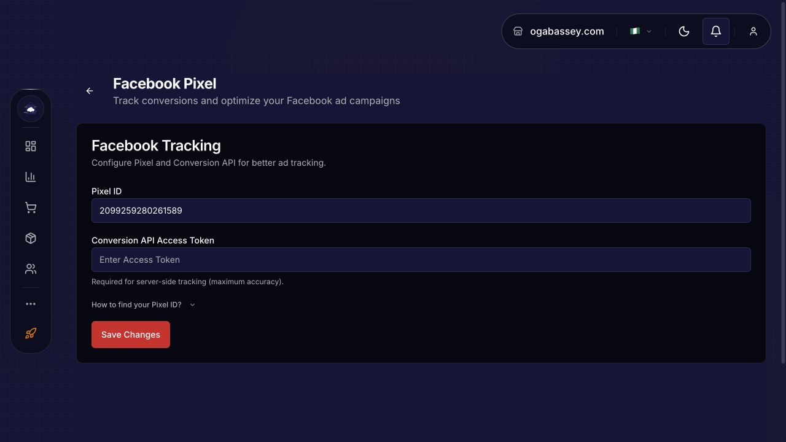
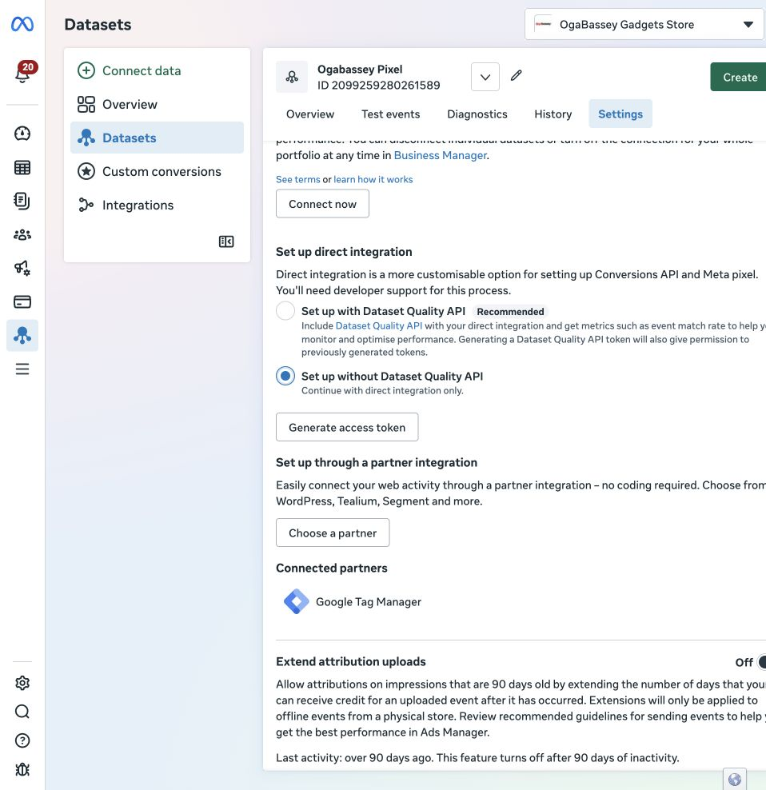
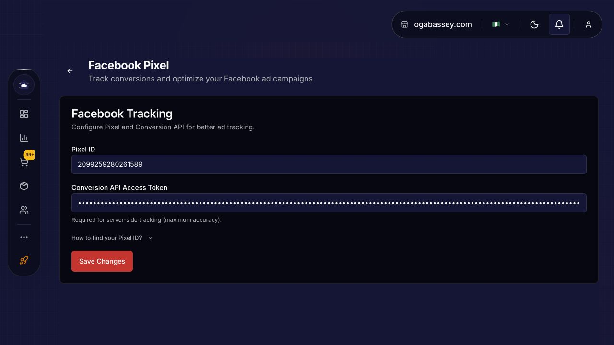
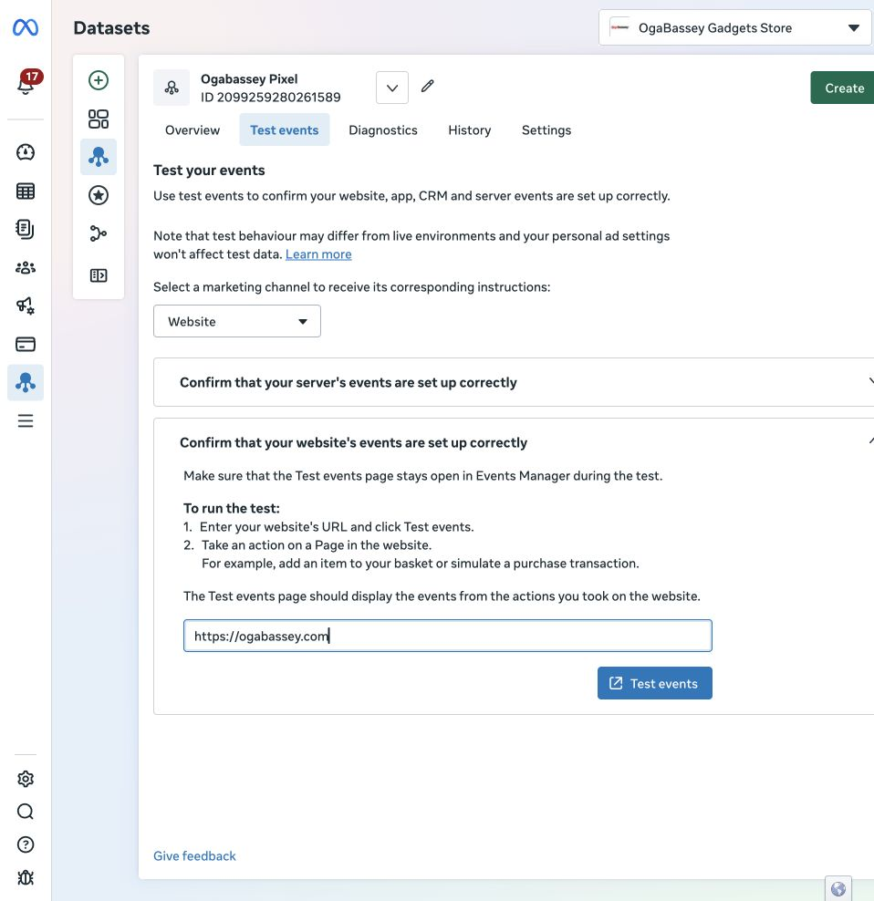
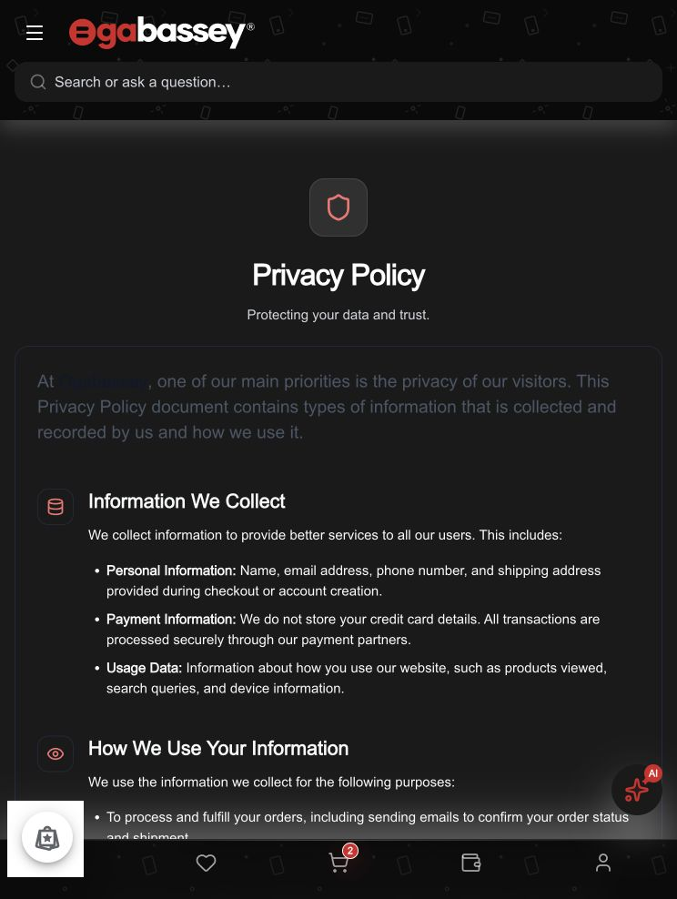

# Connect Facebook / Meta tracking to Baci

A merchant walkthrough for connecting an existing website Pixel and Conversions API (CAPI). Screenshots captured on 25 October 2026. Meta may change its interface.

## 1. Find your existing website Pixel

Open Meta Events Manager and select the business portfolio that owns your store. Open **Overview** and inspect the datasets and their activity. Open your website Pixel and check its event history and latest received events.

Copy the website **Pixel / Dataset ID**. Do not substitute a mobile **App ID**. A source showing “Facebook SDK” can be gathering mobile-app events even when the website Pixels have no activity. Choose by the website/domain and recent website events, rather than its name or creation date alone.

For Ogabassey, the activity check found:

| Source | ID | Observed activity |
| --- | --- | --- |
| Ogabassey – Easybuy Gadgets | 354703740472594 | Mobile app / Facebook SDK; 7.8K events in the displayed 28-day period; View content last received 22 minutes before inspection |
| Ogabassey Pixel | 2099259280261589 | Website Pixel; Meta reports no activity in the last 150 days |
| OgaBassey Gadgets Store’s Pixel | 840347717525262 | Website Pixel; Meta reports no activity in the last 593 days |

The active app source is not a replacement website Pixel ID. Among the website Pixels checked, Ogabassey Pixel (2099259280261589) has the most recent historical activity based on Meta’s inactivity-age labels. Meta also shows one connected catalogue for this Pixel; the other Ogabassey Pixel has no connected catalogues. Installments Pixel (516781270628533) reports that it has never received activity.

## 2. Save the Pixel ID in Baci

Sign in to your merchant dashboard. Open **Integrations → Facebook**, paste the website Pixel ID into **Pixel ID**, then select **Save Changes**. Reload the page and confirm the same ID remains.

This screenshot demonstrates a saved setting, not confirmed event delivery. The CAPI token field was empty when captured.

## 3. Set up direct CAPI

In Meta Events Manager, open the same website Pixel’s **Settings**. Find **Conversions API → Set up direct integration**. For a direct integration without Dataset Quality API, select **Set up without Dataset Quality API**.

Select **Generate access token** when you are ready to grant server-event access. Copy the generated token directly into Baci’s Facebook **Conversions API Access Token** field and save. Keep the token private: exclude it from screenshots, recordings, support tickets and this guide. Do not select a portfolio-wide integration unless that is your intended scope.

Return to the dashboard after reloading to confirm the saved configuration. A saved credential still needs provider-delivery verification.

Ogabassey’s credential was confirmed present after reloading. The credential itself is excluded from this guide. Dataset Quality API was not enabled; direct CAPI delivers events, while quality monitoring would require additional integration work.

## 4. Verify browser events

In Meta, open the website Pixel’s **Test events** tab, select **Website**, enter your storefront URL, and select **Test events**. Keep Events Manager open.

On the storefront, use the normal cookie-consent controls. Accept the relevant tracking categories to test enabled tracking. Browse a product and check that the expected browser events appear in Meta with the correct source. Also test **Necessary Only** separately: advertising tracking should remain disabled.

If no consent prompt is available, fix that storefront wiring before expecting a fresh visitor’s Pixel to load.

This is a blocker capture, not a successful tracking test. Do not manually inject consent or a Pixel script and treat that as an end-to-end pass.

## 5. Verify successful-payment CAPI delivery

Browser activity does not prove server delivery. Use the merchant’s approved test-order/payment flow and check both Baci’s delivery diagnostics and Meta’s received server event. Confirm the correct dataset, event name, currency, value and order/event identity. Confirm duplicate browser/server purchase events are deduplicated where both are sent.

A checkout visit, pending payment or partial payment is not evidence of a successful-payment conversion. Do not perform a real charge solely to follow this guide without the merchant’s approval.

## Verification record for this walkthrough

- Existing website Pixel ID saved in Baci: confirmed for 2099259280261589.
- Most recent observed activity: mobile-app SDK source, not either website Pixel.
- Browser event receipt: not yet confirmed; missing storefront consent UI was found.
- CAPI credential persistence: confirmed after saving and reloading Baci.
- Server-event receipt: not yet confirmed.
- Consent repair: prepared separately with 13 focused regression tests passing; production deployment not established by this guide.

Complete these checks before describing the connection as live. For a video version, record the public setup and verification screens; stop recording before credential generation or entry, then resume on the saved configuration screen.

## Delivery repair and acceptance checks

The 25 October production retest after #3792 confirmed the consent banner works, but found two additional wiring failures: the public analytics builder received no private plan fields and suppressed the saved Pixel, and the visitor-side CAPI handler attempted to read private provider configuration, returning `404 Merchant not found`.

The repair exposes only a derived `growth_integrations_enabled` capability, preserves the public Facebook ID through the template mapper, and queues validated, host-bound CAPI observations through Baci's existing ingress/router/delivery pipeline. Provider credentials remain in the delivery worker. The browser and queued server event use the same event ID. Client-supplied `Purchase` events are rejected; completed purchases remain server-confirmed.

An HTTP `202` with `queued: true, sent: false` confirms durable acceptance only. Verify the corresponding delivery record and Meta receipt before calling it delivered. The router and delivery worker must be enabled for the intended merchant/destination; do not enable every merchant or platform merely to test one connection. No token regeneration is required for the Baci-side failures above.

Run the public projection regression with `bash supabase/tests/run-storefront-growth-integration-hint-test.sh` against its disposable PostgreSQL container. The fixture covers paid, expired, explicitly granted, malformed and unpublished cases while asserting that private plan data and CAPI credentials stay absent.
