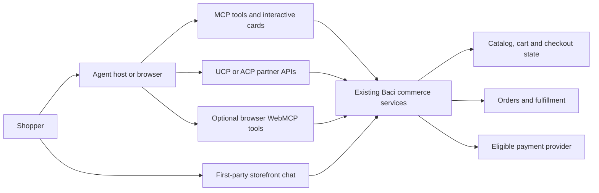

# Baci Agentic Commerce and UCP Completion Plan

> **Status:** Reviewed roadmap, restructured 30 October 2026. It is not a task-by-task execution specification. Before implementing a milestone, write a focused executable plan for it with exact interfaces, files, fixtures, tests and dependencies. This document does not authorize production changes, partner outreach, account activation, deployment, real orders or payments.

**Goal:** Complete and qualify Baci's reusable commerce foundation so supported agents can discover correct products, transfer carts, and—where a partner and PSP explicitly support it—complete and track purchases.

**Architecture:** Keep the existing canonical commerce and shared-cart authority. Implement narrowly scoped ACP/OpenAI, UCP/Google, MCP and first-party chat adapters around it, each with its own version, authentication, payment and event contracts. Ship discovery and website handoff independently of native in-channel checkout. Advertise a capability only when its exact merchant, partner, market, version and execution path qualify.

**Tech stack:** Existing Next.js/TypeScript/React, Supabase/PostgreSQL with RLS and scoped roles, MCP server and apps, Paystack/Kora as currently integrated, Vitest/Jest, pnpm/Turborepo and Biome. Reuse the repository's event delivery, cart, auth and order infrastructure where its authority and delivery guarantees match the task.

**Related documents:**

- Google Pay and agentic plan (`2026-10-29-google-pay-agentic-commerce.md`, not yet on main): supplementary detail for hosted Google Pay, domains and Google merchant accounts. This plan supersedes it for shared agentic/UCP sequencing.
- [Agent access map](../../product/agent-access-map.md), [reviewed capabilities](../../product/baci-capabilities.json) and [evidence workflow](../../product/capability-evidence-workflow.md): the repository's existing capability-evidence system. Evidence produced by this plan extends those files rather than creating parallel matrices.

## How to read this document

1. **Baseline:** what main contains and what is only historical evidence.
2. **Findings register:** every source, specification and partner finding has an ID (`F1`…). Tasks cite IDs instead of restating findings.
3. **Milestones:** release order, starting with Milestone 0 for surfaces Baci already exposes.
4. **Tasks:** numbered in execution order. [Appendix C](#appendix-c--task-number-mapping) maps the previous task numbers.
5. **Appendices:** protocol and channel research (A) and review history (B).

Unless a finding says otherwise, findings are source or specification observations. None has been verified in a deployed environment.

## Baseline

- **Current main:** `1a17a9b900cf951d9df85973cdd1df6b28cd90b7`, fetched 30 October 2026. Earlier reviews used `ccf700e1775f47c340f970a7d8689f5c4b7ff20c`, `06835085bef48b68150ab2a82b57a50c0e77a13b`, `c346c35d5c6b8e176028e57a182bc2faca2cfb33` and `d25480b964e5d3563ac29b408a095d088d0a0e1c`; earlier audits used `11d3af0992600ba26e7d9a69f533ffc6737737b4` and `8972889fa37613fb4400c642bafa030f25767567`. Findings marked ✓ were rechecked at `c346c35d5c` or later, and no agentic, cart, feed, MCP or capability-evidence file has changed since. The others still cite their pinned audit revision.
- **New since the last review:** [PR #3829](https://github.com/ogabasseyy/Baci/pull/3829) adds a first-party Ogabassey storefront chat agent with its own grounded catalog projection (`apps/web/src/app/api/chat/fast-catalog-*`), chat order actions, customer-auth changes and an updated `lib/agentic/agent-commerce-support-chat-health.ts`. It is an agent surface on the same merchant data (see `F30`). [PR #3844](https://github.com/ogabasseyy/Baci/pull/3844) changes only CI/deploy scripts. Since the restructure, [PR #3845](https://github.com/ogabasseyy/Baci/pull/3845) rebound capability evidence to main and [PR #3839](https://github.com/ogabasseyy/Baci/pull/3839) changed storefront shared-cart checkout (free pickup, stale-order reconcile); neither touches `lib/agentic`. [PR #3843](https://github.com/ogabasseyy/Baci/pull/3843) (IMEI migrations) and [PR #3847](https://github.com/ogabasseyy/Baci/pull/3847) (VPS worker release), merged after that, touch nothing in this plan's scope.
- **Shared cart:** [PR #3693](https://github.com/ogabasseyy/Baci/pull/3693) merged on 19 October with canonical carts, versioned commands, scoped access, web/native/MCP adapters, UCP bridging, checkout binding and handoff/merge. Its recorded tests are historical and do not prove current production migration, worker, enrollment or partner status.
- **UCP foundation:** main has a [UCP profile](https://github.com/ogabasseyy/Baci/blob/8972889fa37613fb4400c642bafa030f25767567/apps/web/src/lib/agentic/ucp-shopping-profile.ts), [request adapters](https://github.com/ogabasseyy/Baci/blob/8972889fa37613fb4400c642bafa030f25767567/apps/web/src/lib/agentic/ucp-request-adapters.ts), catalog, cart, checkout and order routes, and [MCP UCP tools](https://github.com/ogabasseyy/Baci/blob/8972889fa37613fb4400c642bafa030f25767567/apps/web/mcp-server/agentic-ucp-tools.ts) at UCP version `2026-04-08`. The canonical cart path uses a feature-gated shared cart and signed fragment handoff; a legacy fallback generates an `agentic_cart_id` query URL. This is a foundation to extend, not evidence of Google onboarding.
- **Other checkout work:** [PR #3833](https://github.com/ogabasseyy/Baci/pull/3833) changes mobile-storefront Baci wallet-funding recovery through Paystack; preserve it, but it proves nothing about Google Pay or UCP token charging. [PR #3837](https://github.com/ogabasseyy/Baci/pull/3837) restored manual-address and Store Pickup checkout (`F29`).
- **Open dependency:** [PR #3790](https://github.com/ogabasseyy/Baci/pull/3790) (exact offer IDs) was open at `9f582d07a0e9948bbbf219a74d88969a329701d3` against `cursor/storefront-typecheck-heap-f21f`, not main, and its SQL validation was incomplete. Recheck its head, base and evidence before relying on it.
- **Local state:** this file is untracked in a checkout that has unrelated dirty work, including agentic catalog/signing files owned by other tasks. Preserve that work. Refresh main and the owning files before implementation.

## Findings register

**Exposure:** `Advertised` = reachable through a surface Baci already publishes (deployment and traffic unverified). `Policy` = conflicts with a current repository rule. `Pre-launch` = must be fixed before the related capability is advertised. `Partner` = external contract or eligibility constraint. `Process` = affects how work is evidenced or reviewed. `Regression guard` = existing behavior a task must preserve.

### Live correctness and policy

| ID | ✓ | Finding | Exposure | Task |
| --- | --- | --- | --- | --- |
| F1 | ✓ | The [UCP catalog adapter](https://github.com/ogabasseyy/Baci/blob/11d3af0992600ba26e7d9a69f533ffc6737737b4/apps/web/src/lib/agentic/ucp-catalog-adapters.ts#L48) emits `price.amount: product.price` unconverted. Storefront prices are major units (the [shared-cart contract](https://github.com/ogabasseyy/Baci/blob/11d3af0992600ba26e7d9a69f533ffc6737737b4/docs/architecture/shared-cart-contract.md#L31); [canonical SQL](https://github.com/ogabasseyy/Baci/blob/11d3af0992600ba26e7d9a69f533ffc6737737b4/supabase/migrations/20261015130000_commerce_cart_final_writer_guards.sql#L75) multiplies by 100), while [UCP catalog](https://ucp.dev/2026-04-08/specification/catalog/) requires minor units, so an agent reads prices 100× too low. The adapter test expects the unconverted value. Catalog routes also hard-code `NGN`. | Advertised | 4 |
| F2 | ✓ | The [checkout calculator](https://github.com/ogabasseyy/Baci/blob/8972889fa37613fb4400c642bafa030f25767567/apps/web/src/lib/agentic/checkout.ts#L84) ignores its `_currency` argument and multiplies the catalog price directly into totals (`price * quantity`). Reproduce each route's actual projection before changing shared amount semantics. | Advertised | 4, 6 |
| F3 | ✓ | The [cart serializer](https://github.com/ogabasseyy/Baci/blob/8972889fa37613fb4400c642bafa030f25767567/apps/web/src/lib/agentic/ucp-cart-response.ts#L28) emits no `line_items[].item.price`, which the [UCP cart specification](https://ucp.dev/2026-04-08/specification/cart/) requires as an integer unit price, and it falls back to the ID when a title is missing. | Advertised | 4, 9 |
| F4 | ✓ | The [fulfillment helper](https://github.com/ogabasseyy/Baci/blob/8972889fa37613fb4400c642bafa030f25767567/apps/web/src/lib/agentic/checkout-fulfillment.ts#L12) hard-codes "Ogabassey Ikeja Store" pickup and "Delivery within Lagos" for every merchant. | Advertised | 4, 6 |
| F5 | ✓ | Agentic catalog search/lookup/product, every `checkout_sessions` handler and `orders/[id]` call `createAdminClient()` for user-facing requests. [`service-role-exceptions.md`](../../agent-guidance/service-role-exceptions.md) has no agentic exception, and all legacy exceptions expired on 2026-09-16. Carts already use a scoped merchant-context RPC. | Policy | 2 |
| F6 | | The [agent payment manifest](https://github.com/ogabasseyy/Baci/blob/8972889fa37613fb4400c642bafa030f25767567/apps/web/src/lib/agentic/agent-commerce-manifest.ts) can advertise Google Pay although completion creates a Paystack DVA rather than charging the token. The [legacy OpenAI feed](https://github.com/ogabasseyy/Baci/blob/8972889fa37613fb4400c642bafa030f25767567/apps/web/src/app/api/feed/openai/legacy-feed-generator.ts) sets `enable_checkout: true` on every row. Neither proves partner integration. | Advertised | 3, 8, 13 |
| F7 | | The [cart and catalog capability declarations](https://github.com/ogabasseyy/Baci/blob/8972889fa37613fb4400c642bafa030f25767567/apps/web/src/lib/agentic/ucp-shopping-profile.ts#L53) omit the `schema` URL that the [April UCP reference](https://ucp.dev/2026-04-08/specification/reference/) requires and that [Google's example](https://developers.google.com/merchant/ucp/implementation/2026-04-08/publish-profile) includes. | Advertised | 3, 5 |
| F8 | | Ogabassey's public UCP profile returned HTTP 200 earlier (catalog/cart/order; no checkout, payment handler or signing keys), then HTTP 403 from this environment. The cause and Google's access are unknown. | Advertised | 1, 12 |
| F30 | | The first-party storefront chat from [PR #3829](https://github.com/ogabasseyy/Baci/pull/3829) builds its own catalog projection from `products` and `get_storefront_product_variants`, separate from the agentic `checkout-catalog` lookup. Price, offer and stock parity with the UCP/ACP surfaces is unverified, and the chat's order actions are a buyer-authority surface. | Advertised | 1, 7, 15 |
| F31 | | The existing [agent access map](../../product/agent-access-map.md) and [reviewed capabilities](../../product/baci-capabilities.json) already record each capability as `code_evidenced`, `production_verified` or `unverified`; those are the only statuses `register_status.py` and `platform_capabilities.py` accept. Edits require regenerating `evidence_digest`/`claims_digest`, and any change to a content-bound cited source file fails the binding test until the claim is re-reviewed. Previous versions of this plan proposed separate evidence and channel matrices. | Process | 1, 18 |
| F33 | ✓ | `calculateCheckoutSession` totals are major units, and four internal consumers depend on that: [checkout storage](https://github.com/ogabasseyy/Baci/blob/ccf700e1775f47c340f970a7d8689f5c4b7ff20c/apps/web/src/lib/agentic/checkout-storage.ts#L133) (major-unit `NUMERIC` columns), [completion authorization](https://github.com/ogabasseyy/Baci/blob/ccf700e1775f47c340f970a7d8689f5c4b7ff20c/apps/web/src/lib/agentic/checkout-authorization.ts#L199) (`× 100` before comparing), [order payloads](https://github.com/ogabasseyy/Baci/blob/ccf700e1775f47c340f970a7d8689f5c4b7ff20c/apps/web/src/lib/agentic/checkout-completion-payloads.ts#L55) (unit price into `create_storefront_order`) and the [DVA webhook](https://github.com/ogabasseyy/Baci/blob/ccf700e1775f47c340f970a7d8689f5c4b7ff20c/apps/web/src/lib/agentic/paystack-dva-webhook.ts#L144) (`p_amount` in major units). The responses disagree: the [UCP checkout/order adapter](https://github.com/ogabasseyy/Baci/blob/ccf700e1775f47c340f970a7d8689f5c4b7ff20c/apps/web/src/lib/agentic/ucp-response-adapters.ts#L352) and [order line-item adapter](https://github.com/ogabasseyy/Baci/blob/ccf700e1775f47c340f970a7d8689f5c4b7ff20c/apps/web/src/lib/agentic/ucp-order-line-item-adapter.ts#L95) apply `Math.round` without `× 100`, so `orders/[id]` and UCP checkout emit rounded major units (19.99 → 20); the ACP response builders ([session state](https://github.com/ogabasseyy/Baci/blob/1a17a9b900cf951d9df85973cdd1df6b28cd90b7/apps/web/src/lib/agentic/checkout-session-response.ts#L10), [payment pending](https://github.com/ogabasseyy/Baci/blob/1a17a9b900cf951d9df85973cdd1df6b28cd90b7/apps/web/src/lib/agentic/checkout-completion-response.ts#L51) and [pay-on-delivery](https://github.com/ogabasseyy/Baci/blob/1a17a9b900cf951d9df85973cdd1df6b28cd90b7/apps/web/src/lib/agentic/checkout-pay-on-delivery-payloads.ts#L101)) and the [order-created webhook](https://github.com/ogabasseyy/Baci/blob/1a17a9b900cf951d9df85973cdd1df6b28cd90b7/apps/web/src/lib/agentic/checkout-order-lifecycle.ts#L13) pass major-unit amounts through although OpenAI's [checkout spec](https://developers.openai.com/commerce/specs/checkout) defines totals as integers in minor units; and UCP checkout is built by [wrapping the ACP response](https://github.com/ogabasseyy/Baci/blob/ccf700e1775f47c340f970a7d8689f5c4b7ff20c/apps/web/src/lib/agentic/ucp-response-adapters.ts#L10), so converting in both layers would apply `× 100` twice. The same trap exists for carts: the [canonical bridge](https://github.com/ogabasseyy/Baci/blob/1a17a9b900cf951d9df85973cdd1df6b28cd90b7/apps/web/src/lib/agentic/ucp-canonical-cart.ts#L140) passes minor units (`lineTotalMinor`, `subtotalMinor`, `totalMinor`) into the cart serializer that the legacy path feeds with major units. The [`base_amount` type comment](https://github.com/ogabasseyy/Baci/blob/ccf700e1775f47c340f970a7d8689f5c4b7ff20c/apps/web/src/lib/agentic/checkout.ts#L26) still asks which unit it holds. | Advertised | 4 |
| F34 | ✓ | When a merchant's `shared_cart_enabled` feature is off, the [legacy cart fallback](https://github.com/ogabasseyy/Baci/blob/ccf700e1775f47c340f970a7d8689f5c4b7ff20c/apps/web/src/lib/agentic/ucp-cart-route-support.ts#L109) and [cart route](https://github.com/ogabasseyy/Baci/blob/ccf700e1775f47c340f970a7d8689f5c4b7ff20c/apps/web/src/app/api/agentic/carts/route.ts#L289) emit `/cart?agentic_cart_id=…`, but nothing in the repository reads that parameter; only the fragment handoff is redeemed. [PR #2031](https://github.com/ogabasseyy/Baci/pull/2031) added the link in May 2026 without a reader, so it has never worked. The profile declares cart whenever agent auth is configured, regardless of the flag, so such a merchant hands buyers an empty cart. | Advertised | 3, 9 |
| F37 | ✓ | The scoped [`resolve_agentic_merchant_context`](https://github.com/ogabasseyy/Baci/blob/ccf700e1775f47c340f970a7d8689f5c4b7ff20c/supabase/migrations/20261015179900_agentic_merchant_context_no_subaccount.sql) RPC deliberately returns a null `paystack_subaccount_code`; that choice dates from when the RPC was anon-callable, and since [`20261015179995`](https://github.com/ogabasseyy/Baci/blob/1a17a9b900cf951d9df85973cdd1df6b28cd90b7/supabase/migrations/20261015179995_agentic_merchant_context_authority.sql#L66) only the server-minted, slug-bound `agentic_merchant_context` role can execute it. Checkout completion passes the merchant's subaccount to [payment setup](https://github.com/ogabasseyy/Baci/blob/ccf700e1775f47c340f970a7d8689f5c4b7ff20c/apps/web/src/lib/agentic/checkout-payment-setup.ts#L56), which returns HTTP 424 when it is missing, so moving the completion handler to that RPC unchanged would fail every DVA completion. | Regression guard | 2 |
| F38 | ✓ | The [completion-authorization schema](https://github.com/ogabasseyy/Baci/blob/ccf700e1775f47c340f970a7d8689f5c4b7ff20c/apps/web/src/schemas/agentic-checkout.ts#L126) requires integer `amount` and `max_amount`, but the [verifier](https://github.com/ogabasseyy/Baci/blob/ccf700e1775f47c340f970a7d8689f5c4b7ff20c/apps/web/src/lib/agentic/checkout-authorization.ts#L199) multiplies both sides by 100 and compares them with the major-unit grand total. A total with kobo (₦39.98) can never be confirmed, and once responses use minor units, a confirmation that echoes the response total would mismatch unless this field is redefined. The signed payloads carry no unit or version marker, and a payment mandate can be session-independent and long-lived. | Pre-launch | 4 |

### Identity, catalog and offer resolution

| ID | ✓ | Finding | Exposure | Task |
| --- | --- | --- | --- | --- |
| F9 | | [Google feed rows](https://github.com/ogabasseyy/Baci/blob/8972889fa37613fb4400c642bafa030f25767567/apps/web/src/app/api/feed/google-merchant/feed-builder.ts#L169) can use `${product.id}-${condition}` IDs and offer IDs, but the [checkout catalog lookup](https://github.com/ogabasseyy/Baci/blob/8972889fa37613fb4400c642bafa030f25767567/apps/web/src/lib/agentic/checkout-catalog.ts#L31) resolves only product/variant UUIDs. | Pre-launch | 8 |
| F10 | | The [legacy](https://github.com/ogabasseyy/Baci/blob/8972889fa37613fb4400c642bafa030f25767567/apps/web/src/lib/agentic/ucp-cart-lane-items.ts#L42) and [canonical](https://github.com/ogabasseyy/Baci/blob/8972889fa37613fb4400c642bafa030f25767567/apps/web/src/lib/agentic/ucp-canonical-cart.ts#L115) cart projections replace a variant's `item.id` with the parent ID; canonical supplies no title. A submitted variant ID does not round-trip. | Pre-launch | 9 |
| F11 | ✓ | [Catalog lookup](https://github.com/ogabasseyy/Baci/blob/11d3af0992600ba26e7d9a69f533ffc6737737b4/apps/web/src/app/api/agentic/catalog/lookup/route.ts#L48) queries `products.id` only, and the [projection](https://github.com/ogabasseyy/Baci/blob/11d3af0992600ba26e7d9a69f533ffc6737737b4/apps/web/src/lib/agentic/ucp-catalog-adapters.ts#L59) emits one parent-ID variant. [UCP lookup](https://ucp.dev/2026-04-08/specification/catalog/lookup/) requires product and variant lookup with input correlation. | Advertised | 7 |
| F12 | | The [search filter helper](https://github.com/ogabasseyy/Baci/blob/11d3af0992600ba26e7d9a69f533ffc6737737b4/apps/web/src/app/api/agentic/catalog/search/route-filters.ts#L37) reads legacy `category`, `min_price`, `max_price`; [UCP search](https://ucp.dev/2026-04-08/specification/catalog/search/) uses `categories` and a nested minor-unit `price` range. Recognized-but-ignored filters mislead. | Advertised | 7 |
| F13 | | The [variant lookup](https://github.com/ogabasseyy/Baci/blob/11d3af0992600ba26e7d9a69f533ffc6737737b4/apps/web/src/lib/agentic/checkout-catalog.ts#L62) does not require a visible parent or the canonical inventory-anchor/default-variant guards; the [calculator](https://github.com/ogabasseyy/Baci/blob/11d3af0992600ba26e7d9a69f533ffc6737737b4/apps/web/src/lib/agentic/checkout.ts#L142) treats a missing nested parent as unmanaged stock. `product_variants` has no lifecycle columns ([migration note](https://github.com/ogabasseyy/Baci/blob/11d3af0992600ba26e7d9a69f533ffc6737737b4/supabase/migrations/20261015175000_commerce_cart_variant_predicate_columns.sql#L1)). | Advertised | 6 |
| F16 | | The [cart request schema](https://github.com/ogabasseyy/Baci/blob/8972889fa37613fb4400c642bafa030f25767567/apps/web/src/schemas/ucp-cart-request.ts#L37) defaults currency to NGN and accepts any three letters. Google's [CreateCart example](https://developers.google.com/merchant/ucp/implementation/2026-04-08/cart-api) sends no currency; UCP treats `context.currency` as a preference the business resolves. | Pre-launch | 6, 9 |
| F35 | ✓ | [`calculateCheckoutSession`](https://github.com/ogabasseyy/Baci/blob/ccf700e1775f47c340f970a7d8689f5c4b7ff20c/apps/web/src/lib/agentic/checkout.ts#L267) quotes `tax: 0` on every line, and [order dispatch](https://github.com/ogabasseyy/Baci/blob/ccf700e1775f47c340f970a7d8689f5c4b7ff20c/apps/web/src/lib/agentic/checkout-order-dispatch.ts#L145) recomputes VAT with `computeAgenticOrderTax` and overrides `p_tax_amount`. No agentic payload sends `expected_total`, so the RPC's `order_total_mismatch` guard is [skipped](https://github.com/ogabasseyy/Baci/blob/ccf700e1775f47c340f970a7d8689f5c4b7ff20c/apps/web/src/lib/agentic/checkout-order-rpc-args.ts#L80). For a VAT-enabled merchant the buyer confirms and pays the VAT-exclusive quote, and the [DVA webhook](https://github.com/ogabasseyy/Baci/blob/ccf700e1775f47c340f970a7d8689f5c4b7ff20c/apps/web/src/lib/agentic/paystack-dva-webhook.ts#L144) records a payment for that amount against an order whose total includes VAT; a pay-on-delivery order, created through the same dispatch, records more than the buyer confirmed. The [dispatch comment](https://github.com/ogabasseyy/Baci/blob/ccf700e1775f47c340f970a7d8689f5c4b7ff20c/apps/web/src/lib/agentic/checkout-order-dispatch.ts#L120) records this as a deferral from PR #1622. | Pre-launch | 4, 6 |
| F36 | ✓ | [`toAgenticCheckoutItem`](https://github.com/ogabasseyy/Baci/blob/ccf700e1775f47c340f970a7d8689f5c4b7ff20c/apps/web/src/lib/agentic/ucp-request-adapters.ts#L112) forwards only `{ id, quantity }`, dropping the Baci-only `variant_id`, `condition` and `variant_attributes` that the [UCP cart schema](https://github.com/ogabasseyy/Baci/blob/ccf700e1775f47c340f970a7d8689f5c4b7ff20c/apps/web/src/schemas/ucp-cart-request.ts#L12) already accepts; the [MCP UCP client schema](https://github.com/ogabasseyy/Baci/blob/ccf700e1775f47c340f970a7d8689f5c4b7ff20c/apps/web/mcp-server/agentic-ucp-client.ts#L10) accepts only `id` and `quantity`. UCP line items themselves carry only `item.id`, so a conforming client such as Google can select a variant or condition only through an exact offer ID (F9, F10). | Pre-launch | 6, 9 |

### Protocol, authentication and replay

| ID | ✓ | Finding | Exposure | Task |
| --- | --- | --- | --- | --- |
| F14 | | [Cart creation](https://github.com/ogabasseyy/Baci/blob/8972889fa37613fb4400c642bafa030f25767567/apps/web/src/app/api/agentic/carts/route.ts#L31) requires Baci's bearer key, a signed mutation envelope and an agent ID. Google documents [`X-API-Key`, OAuth or mTLS](https://developers.google.com/merchant/ucp/guides/overview/authentication). | Pre-launch | 5 |
| F15 | ✓ | The [cart update route](https://github.com/ogabasseyy/Baci/blob/8972889fa37613fb4400c642bafa030f25767567/apps/web/src/app/api/agentic/carts/%5Bid%5D/route.ts) exports `GET` and `POST`; the [UCP REST binding](https://ucp.dev/2026-04-08/specification/cart-rest/) specifies `PUT`, so a conforming update is rejected. A `2026-04-08` cart declaration carries only `version`, `spec` and `schema`, with every operation relative to one service endpoint, so it cannot mark update as unsupported; the binding does not say which operations are mandatory. The [profile's `operations` map](https://github.com/ogabasseyy/Baci/blob/ccf700e1775f47c340f970a7d8689f5c4b7ff20c/apps/web/src/lib/agentic/ucp-shopping-profile.ts#L89) (create, get, update, cancel, convert) is a Baci extension that conforming agents need not read, and `convert_cart_to_checkout` is not a cart REST operation. The [canonical bridge](https://github.com/ogabasseyy/Baci/blob/8972889fa37613fb4400c642bafa030f25767567/apps/web/src/lib/agentic/ucp-canonical-cart.ts#L77) fences unversioned mutations and returns `checkout_requires_handoff` for conversion. Those fences stay. Google's initial flow uses `CreateCart` only. | Advertised | 3, 6, 9 |
| F17 | | The [calculator](https://github.com/ogabasseyy/Baci/blob/8972889fa37613fb4400c642bafa030f25767567/apps/web/src/lib/agentic/checkout.ts#L175) drops unresolved lines and records stock errors, but [cart creation](https://github.com/ogabasseyy/Baci/blob/8972889fa37613fb4400c642bafa030f25767567/apps/web/src/app/api/agentic/carts/route.ts#L141) forwards no messages and the canonical bridge discards snapshot warnings. See Google's [error guide](https://developers.google.com/merchant/ucp/guides/overview/error-codes). | Pre-launch | 6, 9 |
| F18 | | [Idempotency records](https://github.com/ogabasseyy/Baci/blob/8972889fa37613fb4400c642bafa030f25767567/apps/web/src/lib/agentic/idempotency.ts#L10) last 24 hours (the UCP REST minimum); [handoff grants](https://github.com/ogabasseyy/Baci/blob/8972889fa37613fb4400c642bafa030f25767567/supabase/migrations/20261015143000_commerce_cart_handoff_attachment_lifetime.sql#L115) last at most five minutes and are single-use. A replay can return an expired or consumed link. | Pre-launch | 9 |
| F19 | | The [response helper](https://github.com/ogabasseyy/Baci/blob/8972889fa37613fb4400c642bafa030f25767567/apps/web/src/lib/agentic/idempotency-response-storage.ts#L37) stores response JSON verbatim, including the `continue_url` credential, although the handoff table stores only a hash. | Pre-launch | 9 |
| F20 | | [Cart creation](https://github.com/ogabasseyy/Baci/blob/8972889fa37613fb4400c642bafa030f25767567/apps/web/src/app/api/agentic/carts/route.ts#L166) inserts the cart before storing the response; a storage failure returns 503 without the handle. After the [two-minute stale reclaim](https://github.com/ogabasseyy/Baci/blob/8972889fa37613fb4400c642bafa030f25767567/apps/web/src/lib/agentic/idempotency-expiry.ts#L4), a new request ID can create a second cart. Source-level scenario, not observed. | Pre-launch | 9 |
| F21 | | The response store updates by key without a reservation-generation check, so a late original may overwrite a reclaimed retry. The route caches a canonical-bridge 503 with a cart handle, but Google calls only `CreateCart`. | Pre-launch | 9 |
| F22 | ✓ | The [request-record unique index](https://github.com/ogabasseyy/Baci/blob/11d3af0992600ba26e7d9a69f533ffc6737737b4/supabase/migrations/20260430143000_add_agentic_request_and_idempotency_records.sql#L11) is `(merchant_id, request_id)`; later migrations added `route` and `agent_id` columns, which the [reservation helper](https://github.com/ogabasseyy/Baci/blob/11d3af0992600ba26e7d9a69f533ffc6737737b4/apps/web/src/lib/agentic/request-replay.ts#L55) records, without widening it. Two partners can collide on one merchant's request ID. | Pre-launch | 5 |
| F23 | ✓ | `MCP_ALLOWED_HEADERS` in `mcp-server/server.ts` lists `content-type, authorization, mcp-protocol-version, mcp-session-id`, not the [MCP `2026-07-28`](https://blog.modelcontextprotocol.io/posts/2026-07-28/) `Mcp-Method`/`Mcp-Name` headers. Browser preflight impact is untested. The [`2026-07-28` transport](https://modelcontextprotocol.io/specification/2026-07-28/basic/transports/streamable-http.md) requires `MCP-Protocol-Version` and `Mcp-Method` on every POST and `Mcp-Name` on `tools/call`, `resources/read` and `prompts/get`, rejects a missing or mismatched header with HTTP 400 (`-32020`), removes protocol-level sessions, and requires each request's `_meta` to carry the protocol version and client capabilities. | Pre-launch | 5 |
| F24 | | The generated [OpenAPI](https://github.com/ogabasseyy/Baci/blob/8972889fa37613fb4400c642bafa030f25767567/apps/web/src/app/openapi.json/route.ts) lists catalog, checkout and order, but no cart routes. | Process | 7 |
| F32 | | Google Merchant Center [auth](https://github.com/ogabasseyy/Baci/blob/8972889fa37613fb4400c642bafa030f25767567/apps/web/src/app/api/integrations/google-merchant-center/auth/route.ts) and [webhook](https://github.com/ogabasseyy/Baci/blob/8972889fa37613fb4400c642bafa030f25767567/apps/web/src/app/api/integrations/google-merchant-center/webhook/route.ts) are stubs. The [OpenAI webhook helper](https://github.com/ogabasseyy/Baci/blob/8972889fa37613fb4400c642bafa030f25767567/apps/web/src/lib/agentic/webhooks.ts) signs events but has no durable retry; no Google signed lifecycle sender exists. | Pre-launch | 11, 14 |
| F39 | | OpenAI's [checkout page](https://developers.openai.com/commerce/specs/checkout) still shows `API-Version: 2025-09-12`, but the [ACP repository](https://github.com/agentic-commerce-protocol/agentic-commerce-protocol) has released specs through `2026-04-17`. Its [checkout RFC](https://github.com/agentic-commerce-protocol/agentic-commerce-protocol/blob/main/rfcs/rfc.agentic_checkout.md) requires integer minor-unit amounts and an `Idempotency-Key` on every POST (missing: 400 `idempotency_key_required`), and asks servers to answer an unsupported `API-Version` with 400 and `supported_versions`. `2026-04-17` also adds cart, feed and 3DS2 delegated-authentication capabilities. Every ACP-facing plan must pin one version. | Pre-launch | 4, 5 |
| F40 | ✓ | The [MCP server card](https://github.com/ogabasseyy/Baci/blob/bec52f60337bc6c3de4a7f8848c26fbb8d26c8a5/apps/web/src/app/.well-known/mcp/server-card.json/route.ts#L15) advertises `protocolVersion` `2025-06-18`, and the [MCP test support](https://github.com/ogabasseyy/Baci/blob/bec52f60337bc6c3de4a7f8848c26fbb8d26c8a5/apps/web/mcp-server/server-test-support.ts#L36) sends the same `mcp-protocol-version`. [MCP `2026-07-28`](https://modelcontextprotocol.io/specification/2026-07-28/server/tools) is current: every request carries the protocol version and client capabilities in `params._meta`, `Mcp-Method` (and `Mcp-Name` for `tools/call`) headers are required, sessions and `initialize` are gone, and `server/discover` is mandatory. | Advertised | 5 |
| F41 | | Baci's [`AGENTIC_API_VERSION`](https://github.com/ogabasseyy/Baci/blob/bec52f60337bc6c3de4a7f8848c26fbb8d26c8a5/apps/web/src/lib/agentic/request-integrity.ts#L5) and the [ACP discovery default](https://github.com/ogabasseyy/Baci/blob/bec52f60337bc6c3de4a7f8848c26fbb8d26c8a5/apps/web/src/lib/agentic/acp-discovery-profile.ts#L10) are `2026-04-30`, but the newest released ACP version is `2026-04-17` (checked 31 October); `2026-04-30` has no release. Verify what OpenAI accepts before advertising it to a partner. | Partner | 5 |
| F42 | | The [UCP order adapter](https://github.com/ogabasseyy/Baci/blob/bec52f60337bc6c3de4a7f8848c26fbb8d26c8a5/apps/web/src/lib/agentic/ucp-response-adapters.ts) emits a fulfillment event for every order, including the default `pending` status, with quantity 0 for lines nothing has shipped. The [UCP order schema](https://ucp.dev/2026-04-08/specification/order/rest/) requires a quantity of at least 1, so a newly placed order's response fails the schema. Found by plan 2's conformance baseline; not yet independently reproduced. | Advertised | 4 |

### Partner and checkout constraints

| ID | Finding | Exposure | Task |
| --- | --- | --- | --- |
| F25 | Per [Google's Merchant Center guidance](https://developers.google.com/merchant/ucp/guides/overview/merchant-center), eligible free listings enter cart transfer **by default** once the cart capability is declared; `native_commerce(cart_eligibility)=FALSE` opts a product out. Checkout eligibility (`native_commerce(checkout_eligibility)`; plain `native_commerce` remains an alias) defaults false. The whole group is replaced on every upload, so a feed that sends one flag clears the other. | Partner | 3, 8 |
| F26 | Google's [product restrictions](https://developers.google.com/merchant/ucp/guides/overview/merchant-center#product-restrictions) exclude used and refurbished goods (and other classes) from native checkout. Material for Ogabassey. Cart-transfer rules must be verified separately. | Partner | 8 |
| F27 | The [Merchant Center UCP hub](https://developers.google.com/merchant/ucp/guides/merchant-center/overview) scopes guidance to US sales; the [direct API](https://developers.google.com/merchant/ucp/guides/overview) requires Google approval. Nigeria's [beta free listings](https://support.google.com/google-ads/answer/7101265?hl=en-GB) and Google Pay availability do not establish Nigerian UCP eligibility, which stays unknown. | Partner | 11, 12 |
| F28 | Google's [native-checkout reference](https://developers.google.com/merchant/ucp/implementation/2026-04-08/native-checkout-api) returns HTTP 200 with `ucp.status=error` and no session when everything is out of stock. Baci's calculator keeps the line with an `out_of_stock` message, and the zero-line branch does not cover this. | Partner | 6 |
| F29 | Since [PR #3837](https://github.com/ogabasseyy/Baci/pull/3837), the [quote loader](https://github.com/ogabasseyy/Baci/blob/d25480b964e5d3563ac29b408a095d088d0a0e1c/apps/web/src/components/storefront/ogabassey/pages/checkout/hooks/checkout-shipping-quote-loader.ts) uses `merchant_rates_only` for Nigerian requests without a valid pin, and the [quote route](https://github.com/ogabasseyy/Baci/blob/d25480b964e5d3563ac29b408a095d088d0a0e1c/apps/web/src/app/api/shipping/quotes/route.ts) returns configured rates without carrier calls, distinguishes rate-load failure from no matches, and binds readiness to the current destination and cart. Agentic fulfillment work must preserve this. | Regression guard | 4, 6, 16 |

## Global constraints

- Follow the current repository instructions. No Supabase service-role/admin client for user-facing work. Use authenticated or normal clients, or an existing narrowly authorized scoped role with RLS. Validate the actual caller and merchant; an auth user ID is not a merchant ID.
- Keep OpenAI ACP, Google UCP, MCP and first-party chat authentication separate. A hostname, user-agent, partner-supplied merchant ID, tool name or unsigned callback is not authorization. Never reuse partner credentials across tenants or providers.
- Keep catalog, variant/offer identity, stock, price, currency, shipping, taxes, discounts, fulfillment and order state server-authoritative. No client or agent selects its own trusted price.
- A payment timeout or lost response is **indeterminate**: reconcile provider and local state before any retry. Buyer confirmation, payment authorization, order creation, fulfillment and settlement are separate outcomes.
- Keep live capabilities, feeds, DVA pause/replay semantics, existing carts and OAuth connections unchanged until a tested change is reviewed and authorized for release. `apps/web/src/proxy.ts`, `apps/web/src/config/business-types.ts` and `.env*` changes require explicit authorization. Migrations are append-only.
- Test with deterministic synthetic merchants, customers, carts and mocked PSP/registrar/Google/OpenAI services. This plan implies no account linking, external messages, live transactions, production flag changes, migrations, deployment or store publication.
- Use per-partner fail-closed switches and truthful readiness. A code path, profile, flag, sample feed, enqueued webhook or HTTP 200 is not an accepted product, completed payment, successful delivery or launch.

## Release milestones

| Milestone | Result | Tasks | Depends on |
| --- | --- | --- | --- |
| **0. Correct what is already exposed** | No user-facing admin client on agentic routes; advertised catalog, cart, quote and order surfaces return correct units and merchant-owned fulfillment, or the capability is withdrawn; completions whose VAT the quote omits fail closed; truthful capability claims | 1, 2, 3, 4 | Nothing partner-related |
| **A. Trustworthy foundation** | Partner-scoped auth and replay, consistent commerce authority across surfaces, discoverable contracts | 5, 6, 7, plus the core identity portions of 15 | 0 |
| **B. Discovery and website handoff** | Selected OpenAI/MCP and/or Google discovery and cart flows route eligible shoppers to Baci checkout; each channel qualifies independently | 8, 9, 10, 11, 12 | A. Google sandbox access and approval apply only to the Google route |
| **C. Native checkout** | Verified ACP and/or Google UCP checkout with an approved PSP and reliable order updates | 13, 14, and 12 for the selected partner | A, the checkout portions of 6, the selected partner's Task 8 feed requirements (exact offer IDs, checkout eligibility and product restrictions such as used and refurbished goods), and that partner's access |
| **D. Additional features** | Buyer-authority extensions, browser tools, UCP `2026-08-25`, 3DS actions and new channels where negotiated | 15, 16, 17, 18 | A and actual host/PSP support for each enabled capability |

Milestones release separately. Google cart transfer does not depend on Google Pay token processing or the Google order-lifecycle sender. Ordinary Paystack-hosted Google Pay is a separate checkout path qualified in the Google Pay plan (`2026-10-29-google-pay-agentic-commerce.md`, not yet on main). The optional August UCP version is not required for the first Google cart release.

**Next step:** Milestone 0 runs as six executable plans, one pull request each, landed one at a time. [Plan 1](2026-10-30-agentic-m0-1-admin-client-removal.md) (Task 2) is written; plans 2–6 cover Task 1, Task 3 and Task 4 split into units, VAT, and fulfillment. Ship Task 2 as its own PR, separate from protocol work. Land the Milestone 0 PRs one at a time: they edit files bound to the same capability-register row (Task 1), so each regenerates the digests on top of the previous one. A local mock passing does not establish partner or production readiness.

## Review focus

1. Advertised Google Pay or checkout feed eligibility routes to a path that cannot charge the credential: Tasks 3, 8.
2. Tenant or partner spoofing, unauthenticated Google callbacks, or minting a linked status through public database access must fail: Tasks 2, 5, 11.
3. A duplicate request, conflicting replay, lost provider response, stale cart, partial fulfillment or abandoned challenge cannot create a second charge or order: Tasks 6, 9, 13, 14.
4. Used/refurbished products are never marked eligible for Google native checkout. An out-of-stock variant, inactive offer, unknown stock, price mismatch or stale feed never becomes an eligible or differently priced order: Tasks 4, 6, 8.
5. A version upgrade, bad signature, revoked key, unavailable worker, expired handoff or missing event receipt never falls back to broader authority or reports completion: Tasks 1, 5, 9, 12, 14.
6. A unit change converts exactly once on every response path (UCP checkout wraps the ACP response), and stored replays, buyer confirmations and MCP tool output keep a stated unit: Tasks 4, 6.

---

## Milestone 0 — Correct what is already exposed

### Task 1 — Baseline and evidence

**Previously:** Task 0. **Findings:** F8, F30, F31.

**Files:** [agent access map](../../product/agent-access-map.md), [reviewed capabilities](../../product/baci-capabilities.json), [evidence workflow](../../product/capability-evidence-workflow.md), [shared cart contract](https://github.com/ogabasseyy/Baci/blob/8972889fa37613fb4400c642bafa030f25767567/docs/architecture/shared-cart-contract.md), [cart rollout](https://github.com/ogabasseyy/Baci/blob/8972889fa37613fb4400c642bafa030f25767567/docs/deploy/shared-cart-rollout.md), [ACP handler](https://github.com/ogabasseyy/Baci/blob/8972889fa37613fb4400c642bafa030f25767567/apps/web/src/app/api/agentic/checkout_sessions/checkout-session-create-handler.ts), [UCP profile constants](https://github.com/ogabasseyy/Baci/blob/8972889fa37613fb4400c642bafa030f25767567/apps/web/src/lib/agentic/ucp-profile-constants.ts), [MCP server](https://github.com/ogabasseyy/Baci/blob/8972889fa37613fb4400c642bafa030f25767567/apps/web/mcp-server/server.ts).

- [ ] Refresh `origin/main` read-only and map affected code, schemas, tests, open PRs and dirty work. Compare the repository migration registry with an authorized read-only environment ledger; never infer applied migrations or activation from source.
- [ ] Extend the existing capability evidence, not a new matrix. In `baci-capabilities.json`, keep the row schema and the `code_evidenced` / `production_verified` / `unverified` status enum, then run `python3 vps-workers/baci-editorial-context/register_digests.py --write` and update the review date and revision in `agent-access-map.md`. Put the per-surface detail (`partner`, `version`, `merchant`, `source_revision`, `local_test`, `staging`, `production`, `partner_receipt`, with `unknown` as an explicit state) in a table in `agent-access-map.md`. Never record credentials or buyer data.
- [ ] The register's `agent-protocols` row (`code_evidenced`) content-binds nine agentic files: `apps/web/src/app/.well-known/ucp/route.ts`; `apps/web/src/app/api/agentic/{carts/route,carts/[id]/checkout/route,catalog/search/route,checkout_sessions/route,orders/[id]/route}.ts`; and `apps/web/src/lib/agentic/{acp-discovery-profile,agent-commerce-manifest,ucp-shopping-profile}.ts`. Tasks 2–4 edit several of them, so each PR re-reviews that row's claim and limitations and regenerates both digests (F31). Sequence those PRs or regenerate after every rebase; parallel PRs conflict on the digests.
- [ ] Record separate rows for OpenAI MCP handoff, ACP direct checkout, Google UCP cart, Google UCP native checkout, ordinary Paystack-hosted Google Pay, first-party storefront chat and multi-merchant onboarding, each with target market, currency, eligible products and actual authentication.
- [ ] Pin representative `2026-04-08` Google UCP and current MCP request/response fixtures. Add ACP fixtures when that channel is pursued; missing OpenAI access does not block Google cart work. Build a harness with two synthetic merchants, agents and customers, price/stock variants, new and used items, and fake PSP/webhook outcomes. Record fixture bytes and partner version, never secrets.
- [ ] Record the HTTP 200 and later 403 profile observations separately (F8). Recheck the Google-accessible profile, response schema and WAF behavior with approved read-only diagnostics. Do not spoof Google or change `proxy.ts` or firewall settings.

**Acceptance:** Every surface, including storefront chat, has an evidence row in the existing capability files and a named owner for its next check. No `unknown` is shown as success.

### Task 2 — Remove user-facing admin-client edges

**Previously:** Task 2. **Findings:** F5, F37. Ship as a standalone PR.

**Files:** [merchant context](https://github.com/ogabasseyy/Baci/blob/8972889fa37613fb4400c642bafa030f25767567/apps/web/src/lib/agentic/merchant-context.ts), [cart scoped context](https://github.com/ogabasseyy/Baci/blob/8972889fa37613fb4400c642bafa030f25767567/apps/web/src/lib/agentic/ucp-cart-route-support.ts), `apps/web/src/app/api/agentic/catalog/{search,lookup,product}/route.ts`, `apps/web/src/app/api/agentic/checkout_sessions/**`, `apps/web/src/app/api/agentic/orders/[id]/route.ts`, `apps/web/src/lib/agentic/checkout-payment-setup.ts` and tests. Add append-only SQL and disposable RLS tests only if the existing scoped context cannot satisfy the contract.

- [ ] Inventory each `createAdminClient()` call and read projection on current main. Separate unrelated privileged workers from user-facing requests. Reuse the scoped merchant-context RPC that UCP carts already use where its authority fits.
- [ ] Write tests for missing/invalid/expired partner credentials, wrong tenant, wrong configured slug, forged host, unauthorized order/cart ID and insufficient permissions. Assert no cross-merchant data, private token or business mutation is returned.
- [ ] On main, nine user-facing call sites (catalog search, lookup and product; checkout-session create, get, update, cancel and complete; `orders/[id]`) use `createAdminClient()` only to call `resolveAgenticMerchantContext(bootstrap)`; their data reads already use the scoped agentic client. Confirm that before switching. The complete handler also passes `bootstrap` into `completeAgenticPayOnDelivery`, which never reads it; remove that parameter in the same PR.
- [ ] **Payment split (F37):** `resolveAgenticMerchantContextFromRpc()` returns a null Paystack subaccount by design, and completion needs it. Do not move the complete handler to it unchanged. Chosen in [plan 1](2026-10-30-agentic-m0-1-admin-client-removal.md): a separate `resolve_agentic_merchant_payment_split` function under the same slug-bound `agentic_merchant_context` role, read only by completion. The shared projection keeps withholding the subaccount, as `supabase/tests/agentic_merchant_context_authority.sql` deliberately requires. Add a regression test that completion forwards the merchant's exact subaccount and still fails closed with 424 when none is configured.
- [ ] Replace each user-facing bootstrap with a normal-client or authorized machine-role/RLS design. For multiple merchants, bind the verified partner principal and trusted store host to the merchant. Keep the configured-slug path for existing clients until a compatible migration is proven.
- [ ] Test authorized single- and two-merchant requests, credential rotation/revocation and lookup errors. Run the affected catalog, checkout, order, merchant-context and disposable SQL/RLS tests. Never grant an existing broad RPC to clients to make a test pass.

**Acceptance:** No user-facing agentic route on main imports an admin client, each request has verifiable partner and tenant authority, and existing authorized requests still work, including DVA completion with the merchant's Paystack subaccount.

### Task 3 — Truthful capability and eligibility claims

**Previously:** Task 1. **Findings:** F6, F7, F15, F25, F34.

**Files:** [agent manifest](https://github.com/ogabasseyy/Baci/blob/8972889fa37613fb4400c642bafa030f25767567/apps/web/src/lib/agentic/agent-commerce-manifest.ts) and [its tests](https://github.com/ogabasseyy/Baci/blob/8972889fa37613fb4400c642bafa030f25767567/apps/web/src/lib/agentic/agent-commerce-manifest.test.ts), [UCP payment profile tests](https://github.com/ogabasseyy/Baci/blob/8972889fa37613fb4400c642bafa030f25767567/apps/web/src/lib/agentic/ucp-discovery-profile-payment.test.ts), [legacy feed generator](https://github.com/ogabasseyy/Baci/blob/8972889fa37613fb4400c642bafa030f25767567/apps/web/src/app/api/feed/openai/legacy-feed-generator.ts), `apps/web/src/lib/agentic/{ucp-shopping-profile,ucp-cart-route-support}.ts`, `apps/web/src/app/.well-known/ucp/route.ts`, `apps/web/src/app/api/agentic/carts/**` and the capability register (`docs/product/baci-capabilities.json`, `docs/product/agent-access-map.md`).

**Interface:** Checkout availability comes from a server-owned capability decision scoped to merchant, partner, market, protocol version, product and actual payment handler. Client-provided booleans never authorize checkout.

- [ ] Add failing tests showing a configured Paystack Google Pay handler is omitted when UCP completion would only create a DVA. Cover DVA paused/unpaused, pay-on-delivery, missing secret and existing supported methods.
- [ ] Add feed tests showing a product without proven ACP eligibility does not opt into native checkout. Keep search/discovery eligibility independent and check existing format consumers before changing published output.
- [ ] Make Google cart advertisement conditional on a working, authorized merchant-specific handoff and a reviewed eligibility policy (F25). Assess any already-advertised profile and existing traffic before a separately authorized rollout change.
- [ ] **Dead legacy cart URL (F34):** when a merchant's `shared_cart_enabled` feature is off, withhold the cart capability from that merchant's `.well-known/ucp` (`hasCartCapability` checks only agent auth today) and fail `POST /api/agentic/carts` closed, instead of emitting an unredeemable `?agentic_cart_id=` link. Do not add a reader for it (Task 9 forbids a second handoff system). Record in Task 1 whether the flag is on for each agentic merchant. In the profile, add `shared_cart_enabled` to the `MerchantPaymentConfig` pick that `buildAgentCommerceManifest` receives; the cached storefront merchant already carries it, derived from the same `premium_features` entry the cart gate reads, but cached, so test that a flag change reaches both. In the cart routes, check the flag before reserving the idempotency key or request ID: `POST /api/agentic/carts` inserts the legacy row before it calls `handleCanonicalUcpCart`, so failing only when that returns `null` would leave an orphan legacy cart. Apply the same gate to the other `/api/agentic/carts/*` routes.
- [ ] **Cart update method (F15):** a cart declaration cannot mark update as unsupported, and withholding cart would end Google cart transfer (F25). Default for Milestone 0: keep the declaration for Google's `CreateCart`-only flow, record "update via `PUT` is not supported" in the `agent-protocols` limitations and the access map, and confirm with Google that a create-only implementation is acceptable (Task 9). Editing the Baci `operations` map is not a substitute; conforming agents need not read it. If a generic UCP partner needs updates first, pull Task 9's version-carrying `PUT` forward. Never add an unversioned full-replacement `PUT`; it would bypass the canonical cart's concurrency fence.
- [ ] Withdraw or correct any advertised capability that Task 4 cannot make correct.
- [ ] Implement fail-closed capability decisions with independent readiness reasons. A hosted-website Google Pay checkbox is not the ability to charge a UCP token. Preserve Paystack/DVA replay controls.
- [ ] Run `pnpm --filter @baci/web exec vitest run src/lib/agentic/agent-commerce-manifest.test.ts src/lib/agentic/ucp-discovery-profile-payment.test.ts src/app/api/feed/openai/legacy-feed-generator.test.ts` and any new eligibility tests.

**Acceptance:** An unqualified merchant, product or handler cannot be advertised as native-checkout-ready, and any advertised cart limitation is recorded in the capability evidence. Existing discovery, website checkout and other payment methods keep working.

### Task 4 — Correct amounts and fulfillment on advertised surfaces

**Previously:** the live-exposure parts of Tasks 4 and 12. **Findings:** F1, F2, F3, F4, F29, F33, F35, F38, F39.

**Files:** `apps/web/src/lib/agentic/{ucp-catalog-adapters,ucp-cart-response,ucp-response-adapters,ucp-order-line-item-adapter,checkout-session-response,checkout-completion-response,checkout-pay-on-delivery-payloads,checkout-order-lifecycle,checkout-authorization,checkout-fulfillment,ucp-canonical-cart,checkout-order-tax,checkout-order-rpc-args}.ts`, `apps/web/src/schemas/agentic-checkout.ts`, `apps/web/mcp-server/{server,agentic-ucp-tools}.ts`, the catalog, cart, checkout and `orders/[id]` routes, and colocated tests.

**Unit boundary (F33, F38):** `calculateCheckoutSession` and everything below it (session storage, authorization comparison, order payloads, DVA webhook) stay in major units; do not change its units. Prices are stored as `numeric(10,2)`, so `Math.round(major * 100)` is exact for exponent-2 currencies. Each response path converts exactly once.

- [ ] Add route-level fixtures that show the stored price unit and every conversion boundary. A product priced at NGN 19.99, quantity 2, no fees, must produce a unit price of 1,999 kobo and a subtotal of 3,998 kobo in catalog, canonical cart, legacy cart, ACP and UCP checkout (create, get, update, cancel, complete, and get with a pending payment) and `orders/[id]` responses, and the stored session, authorization comparison, order payload and DVA expected amount must still read ₦39.98. Replace the adapter test that expects the unconverted value.
- [ ] **ACP response:** convert in one shared ACP serializer that every ACP builder uses, so a new builder cannot skip it: `buildCheckoutSessionStateResponse` (create, get, update, cancel and UCP cart-to-checkout), `buildPaymentPendingCheckoutResponse` (complete, get with a pending payment, grandfathered DVA replay) and `buildPayOnDeliveryCheckoutResponse`. Include line items and `fulfillment_options` amounts; stored payment snapshots stay in major units. Give the order-created webhook `total` (`checkout-order-lifecycle.ts`) the same unit, or record the difference until Task 14 settles the ACP webhook contract. OpenAI's [checkout spec](https://developers.openai.com/commerce/specs/checkout) defines `totals[].amount` as an integer in minor units and the other amount fields as integers. Pin the ACP version this response targets (F39).
- [ ] **UCP checkout:** the `checkout-sessions` routes wrap the ACP handler with `adaptCheckoutResponseToUcp`, so the UCP checkout adapter passes integers through and rejects non-integers instead of converting again; a second `× 100` would make totals 10,000× too high. The UCP catalog and order adapters convert from stored major units.
- [ ] **Cart inputs:** canonical cart amounts are already minor (`unitPriceMinor`, `lineTotalMinor`, `subtotalMinor`, `totalMinor`), so they pass through unchanged. Legacy cart amounts come from `calculateCheckoutSession` in major units, so convert them once at the legacy call sites, never inside the shared `buildUcpCartResponse`. Once Task 3's flag gate lands, legacy cart responses should be unreachable; add a test that proves it.
- [ ] **Confirmation unit (F38):** in the same change, make the `completion_authorization` `amount` and the mandate `max_amount` integers in minor units, compared directly against `Math.round(grandTotalMajor * 100)` with no further `× 100` on the authorization side. Add a unit or version marker to the signed payloads. Handle existing authorizations explicitly: reject unmarked ones with a clear error, or accept them as legacy whole-naira values for a stated transition window; never reinterpret them silently. Coordinate the change with every holder of the confirmation keys. Test a total with kobo, a mandate limit, an echoed response total and an unmarked authorization.
- [ ] **Replays and consumers:** idempotent replays return stored response bodies verbatim for 24 hours, so keep a body stored before the change from replaying under the new contract. Update the MCP UCP tools and the gated ACP checkout tools in `mcp-server/server.ts`, which hand amounts to the model verbatim, to state minor units. Correct the `base_amount` comment in `checkout.ts`.
- [ ] Emit integer `line_items[].item.price` in minor units, consistent with totals: from `unitPriceMinor` on the canonical path, and from the once-converted unit price on any legacy path that remains reachable.
- [ ] **VAT guard (F35):** until Task 6 puts VAT in the quote, refuse a *fresh* completion whose order VAT is non-zero, with a clear error, before the pay-on-delivery branch and before payment setup, so no DVA is issued and no order is created. A fresh completion has no committed result and is not in a [transitional payment state](https://github.com/ogabasseyy/Baci/blob/1a17a9b900cf951d9df85973cdd1df6b28cd90b7/apps/web/src/lib/agentic/agentic-dva-cutover-constants.ts#L2) (`claiming_payment`, `payment_account_ready`, `order_finalizing`); the [complete handler](https://github.com/ogabasseyy/Baci/blob/1a17a9b900cf951d9df85973cdd1df6b28cd90b7/apps/web/src/app/api/agentic/checkout_sessions/%5Bid%5D/complete/checkout-session-complete-handler.ts#L205) sends those states down the same path as fresh requests, so the guard must check the state first. Also send `expected_total` (the confirmed quote total) so the order RPC rejects any remaining mismatch. If an agentic merchant is VAT-enabled (Task 1 records this), either pull Task 6's tax parity into Milestone 0 or accept that its agentic completion is blocked until then. Withdrawing discovery claims does not stop direct calls.
- [ ] **Transition rule for in-flight sessions:** committed results (a completed session or a persisted payment-pending response) keep replaying unchanged. Unfinished recovery (`claiming_payment`; `payment_account_ready` with a stored DVA the buyer may already be paying into; `order_finalizing` with a created order) is never rejected by the new guard. Mark sessions that pass the guard so recovery of a session started before rollout is not judged by rules it never saw. Test retries after DVA creation, after order creation but before response persistence, and after the merchant's tax setting changes between attempts.
- [ ] **VAT cutover procedure:** the existing DVA tools cannot certify this rollout alone. The [audit](https://github.com/ogabasseyy/Baci/blob/1a17a9b900cf951d9df85973cdd1df6b28cd90b7/apps/web/src/scripts/audit-agentic-dva-consent-cutover.ts#L33-L36) skips pay-on-delivery `order_finalizing` sessions, the [drain](https://github.com/ogabasseyy/Baci/blob/1a17a9b900cf951d9df85973cdd1df6b28cd90b7/apps/web/src/scripts/drain-agentic-dva-consent-cutover.ts) [accepts only Paystack bank-transfer sessions](https://github.com/ogabasseyy/Baci/blob/1a17a9b900cf951d9df85973cdd1df6b28cd90b7/apps/web/src/lib/agentic/agentic-dva-cutover-evidence.ts#L127), and the [DVA pause](https://github.com/ogabasseyy/Baci/blob/1a17a9b900cf951d9df85973cdd1df6b28cd90b7/apps/web/src/lib/agentic/agentic-paystack-dva-completion-gate.ts#L10) leaves pay-on-delivery open. Before enabling the guard and `expected_total`:
  1. Hold new agentic completions for VAT-enabled merchants on both payment paths during the final audit and rollout, while recovery continues. Do not use the per-merchant checkout switch for this: the complete handler [checks it before reading the session](https://github.com/ogabasseyy/Baci/blob/1a17a9b900cf951d9df85973cdd1df6b28cd90b7/apps/web/src/app/api/agentic/checkout_sessions/%5Bid%5D/complete/checkout-session-complete-handler.ts#L149), so it would also block recovery.
  2. Inventory every transitional session on both paths and finish or explicitly cancel each one, reusing the DVA tools where they fit and adding pay-on-delivery coverage.
  3. Block rollout while either path has an unresolved session.
  4. Test that a pending pay-on-delivery finalization cannot produce an all-clear result.
- [ ] Withhold currencies whose exponent differs from 2 until cart, order and PSP boundaries support them; the canonical SQL multiplies by 100.
- [ ] Replace the hard-coded Ogabassey/Ikeja pickup and Lagos delivery with the selected merchant's configured fulfillment. Where none is available, return a truthful incomplete or handoff state. Never invent free pickup, shipping cost or tax.
- [ ] Add the F29 regression fixtures: Nigerian address with city/state but no valid pin, autocomplete failure, merchant-rate load failure, no matching rates, valid configured pickup, and a late quote after address or cart changes. Assert the merchant-only path makes no carrier call and a failed or stale quote cannot establish readiness.

**Acceptance:** The NGN 19.99 × 2 fixture yields 1,999 / 3,998 kobo on every ACP and UCP response with no double conversion, a total with kobo can be confirmed and completed, a fresh VAT-bearing completion fails before any DVA or order exists, and committed results replay while in-flight sessions finish or are reconciled rather than stranded, and no DVA or pay-on-delivery session is unresolved at rollout; a second synthetic merchant never sees Ogabassey fulfillment; the F29 fixtures pass. Any surface that still fails is withdrawn under Task 3.

---

## Milestone A — Trustworthy foundation

### Task 5 — Protocol versions and partner authentication

**Previously:** Task 3. **Findings:** F7, F14, F22, F23, F39.

**Files:** `apps/web/src/lib/agentic/{auth,request-integrity,mutation-request,ucp-shopping-profile,ucp-discovery-profile}.ts`, `apps/web/src/app/.well-known/ucp/route.ts`, `apps/web/mcp-server/{server,agentic-ucp-request}.ts`, `apps/web/builder-mcp-server/` and tests. Use focused version-specific adapters; do not fork the commerce core.

- [ ] **OpenAI:** compare signed-request and response headers with the approved ACP contract (version, signature encoding and canonical input, timestamps, replay, response correlation). ACP `2026-04-17` requires `Idempotency-Key` on every POST and `supported_versions` in version errors (F39). Preserve existing signed clients.
- [ ] **Google (F14):** compare `X-API-Key`/OAuth/mTLS and actual sandbox headers with Baci's bearer-plus-HMAC envelope. Build a separate authenticated Google adapter that binds the verified principal to the authorized merchant and replay identity. Do not reuse OpenAI's secret or weaken its HMAC checks. Confirm Google's retry and identity headers before choosing idempotency behavior; never mint a fresh idempotency key for an ambiguous retry.
- [ ] **UCP headers:** test `UCP-Agent`, `Request-Id` and `Idempotency-Key` against real partner requests. Parse the agent profile as untrusted metadata and bind identity only after authentication succeeds.
- [ ] **Replay namespace (F22):** separate the request-replay namespace from idempotency before adding partner adapters. Add a disposable-database concurrency fixture for two partners sending the same request ID to one merchant, and keep rejecting real replays within one verified principal. Choose route scope from the partner contract; never trust a caller-supplied agent ID. Cover existing/null-agent rows, legacy idempotency ownership lookup, expiry cleanup, RLS and append-only migration compatibility.
- [ ] **Profile fetches:** restrict fetches of externally supplied profile URLs to approved partner origins, check redirects, DNS and IP boundaries, set timeouts and cache safely (SSRF). Agent identity is not buyer purchase authorization.
- [ ] **Versions:** keep `2026-04-08` fields and `signing_keys`. Reject unsupported versions explicitly instead of relabeling payloads. Defer `2026-08-25` serialization and `keys` to Task 17 unless a selected partner requires them.
- [ ] **Profile validation (F7):** validate the whole discovery profile against the pinned `2026-04-08` schema and Google's example, with schema URLs for every advertised capability and a service base URL that resolves to the tested endpoint. Check a merchant profile and the platform-root profile.
- [ ] **MCP (F23):** test the installed v2 server with relevant host/client versions, OAuth redirects, legacy initialization, stateless requests and browser CORS. Test whether browser preflight needs `Mcp-Method`/`Mcp-Name` before a scoped fix. Preserve tool discovery and the guest-OAuth cart-only restriction.
- [ ] Test capability intersection, unknown capabilities, wrong partner, missing/invalid credentials, malicious profile URL, expired/revoked keys, clock skew and signature errors.

**Acceptance:** Known clients keep working, untrusted requests fail safely, and each partner sees only version-compatible capabilities Baci can execute.

### Task 6 — Shared commerce and checkout authority

**Previously:** the remaining parts of Task 4. **Findings:** F2, F4, F13, F15, F16, F17, F28, F29, F35, F36.

**Files:** `apps/web/src/lib/agentic/{checkout-order-tax,checkout-order-dispatch,ucp-request-adapters}.ts`, `apps/web/src/schemas/ucp-checkout-request.ts`, [checkout calculation](https://github.com/ogabasseyy/Baci/blob/8972889fa37613fb4400c642bafa030f25767567/apps/web/src/lib/agentic/checkout.ts), [fulfillment helper](https://github.com/ogabasseyy/Baci/blob/8972889fa37613fb4400c642bafa030f25767567/apps/web/src/lib/agentic/checkout-fulfillment.ts), [UCP response adapter](https://github.com/ogabasseyy/Baci/blob/8972889fa37613fb4400c642bafa030f25767567/apps/web/src/lib/agentic/ucp-response-adapters.ts), [canonical cart bridge](https://github.com/ogabasseyy/Baci/blob/8972889fa37613fb4400c642bafa030f25767567/apps/web/src/lib/agentic/ucp-canonical-cart.ts), `apps/web/src/lib/cart/`, `packages/shared/src/cart/`, `apps/web/src/app/api/agentic/checkout_sessions/` and tests.

- [ ] Run the synthetic end-to-end matrix through the existing service: correct merchant and offer/variant, integer minor units, available quantity, selected delivery and fee, discount/tax and total. Include unmanaged/unknown stock and conflicting identical-condition offers. Reconcile with any later exact-offer work (PR #3790) before changing identity.
- [ ] **Tax parity (F35):** compute VAT in the quote with the same `computeAgenticOrderTax` logic order dispatch uses, keep sending `expected_total` so the RPC's `order_total_mismatch` guard runs, and lift Task 4's VAT guard only once this passes. The quoted total, the buyer's confirmation, the DVA expected amount and the order total must agree. The dispatch comment notes this changes the `GPTLineItem`/`GPTTotal` shape every agentic consumer reads, so include the UCP adapters, session storage, authorization and MCP tools. Test a VAT-enabled merchant through create, update, confirm, complete and DVA settlement, a pay-on-delivery order, and a VAT-disabled merchant for no change.
- [ ] **Offer identity (F36):** treat `item.id` as the authority and resolve variant and condition from an exact offer ID (F9, F10; reconcile with PR #3790). Accept the Baci-only `variant_id`, `condition` and `variant_attributes` in `ucp-checkout-request.ts` and `toAgenticCheckoutItem` only to match the cart schema for Baci's own clients, and reject any that conflict with `item.id`. Test a used and a new lane of one product reaching distinct checkout lines, and a conflicting lane field being rejected.
- [ ] **Offer guards (F13):** add route and disposable-RLS cases for a draft/unavailable parent, a missing nested parent with a variant price override, inventory-anchor/default variants excluded by the canonical public predicate, and a legitimate public variant. Compare canonical cart, legacy cart and checkout. Do not filter on nonexistent variant lifecycle columns.
- [ ] **Fulfillment:** test two merchants with different options, unknown or unserviceable destinations and a quote-provider failure. Handoff and browser assistance must reach the same valid options as ordinary checkout (F29). Do not generalize Ogabassey pickup to other merchants.
- [ ] **Currency (F16):** treat `context.currency` as a preference resolved against merchant-supported prices; never relabel or convert an amount without an authority. An unsupported explicit payment currency must not create an order or call a provider.
- [ ] **Drift:** stock, price or offer changes after cart or checkout creation must produce a current, reviewable result. Wrong merchant or agent, forged amount and missing shipping must not create an order or invoke a provider.
- [ ] **Concurrency:** test create/update/cancel/complete and transport replays, concurrent writes, stale versions, same idempotency key with a different body, and response loss after committed state. Reuse canonical cart receipts and checkout-binding authority; no second cart database.
- [ ] **Google business errors (F17, F28):** reproduce the all-out-of-stock and partial-stock fixtures and fix the UCP mapping and resource-creation decision if confirmed. Map causes to documented codes (`item_unavailable`, `out_of_stock`, `address_undeliverable`) with correct JSON paths, severity and envelopes; never forward generic `invalid`. Keep malformed/auth failures and ACP semantics correct. Payment timeouts stay indeterminate.
- [ ] **Cart-to-checkout (F15):** for a partner negotiating generic cart and checkout, test `cart_id` conversion, preserved contents and reuse of an incomplete checkout. Keep `checkout_requires_handoff` until an authorized binding meets the contract, and do not claim interoperability while it returns that error.
- [ ] Run affected cart, checkout, UCP/ACP adapter, order and SQL concurrency suites. If `packages/shared` or cross-app contracts change, include mobile consumers and full monorepo checks.

**Acceptance:** The same eligible offer is priced and authorized identically across supported surfaces, and uncertain outcomes never duplicate effects.

### Task 7 — Discoverable, callable commerce functions

**Previously:** Task 12. **Findings:** F11, F12, F24, F30.

**Files:** [cart contract](https://github.com/ogabasseyy/Baci/blob/8972889fa37613fb4400c642bafa030f25767567/docs/architecture/shared-cart-contract.md), `apps/web/src/app/api/storefront/cart/`, `apps/web/src/app/api/agentic/{catalog,carts,checkout_sessions,orders}/`, [API catalog](https://github.com/ogabasseyy/Baci/blob/8972889fa37613fb4400c642bafa030f25767567/apps/web/src/app/.well-known/api-catalog/route.ts), [OpenAPI](https://github.com/ogabasseyy/Baci/blob/8972889fa37613fb4400c642bafa030f25767567/apps/web/src/app/openapi.json/route.ts), `apps/web/src/app/api/chat/fast-catalog-data.ts`, agent auth and tests. Design a public developer API only if approved partner contracts and real consumers need one.

- [ ] Inventory existing operations, schemas, calling principals, scopes, merchant resolution, flags and consumers. Mark each route internal, browser-session-specific, signed-partner-only or callable by an approved agent.
- [ ] **Catalog parity (F11, F30):** bring UCP search, lookup and product responses, and the storefront chat projection, to the same merchant-authoritative offer and currency contract as carts. Test `price.amount` and `price_range` in minor units with decimal prices, multiple real variants and offers, inactive parents and valid zero prices. Do not emit a fabricated parent-only variant that hides a real choice.
- [ ] **Lookup (F11):** test lookup by product ID, variant ID and duplicates with `inputs` correlation; do not resolve variant IDs from the products table alone.
- [ ] **Filters (F12):** test `filters.categories` and `filters.price.min/max`, converting between minor units and stored prices exactly once. Surface an ignored-filter message where the contract requires it. Keep legacy aliases for known consumers.
- [ ] **Published contract (F24):** publish an accurate, versioned description of proven cart capabilities, deciding whether they belong in the OpenAPI document or a separately scoped contract. Never advertise storefront cookies, internal RPCs, privileged credentials or unsupported payment methods.
- [ ] Specify agent-readable inputs and outputs for search/detail, exact variant and condition, stock/price, cart create/read/change, shipping or checkout quote, website handoff, authorized order status and public policies. Distinguish unavailable, unknown and stale values. Model output and feed metadata never set a trusted price.
- [ ] Define permissions separately for public catalog, isolated guest cart, authenticated shopper, partner checkout and order access. Bind each cart grant to a merchant and buyer/session with expiry, quotas and revocation. A cart grant never approves payment or grants access to another order, and carts never link or merge without the existing consent rules.
- [ ] Test two merchants and two shoppers across agent → cart → website and website → linked-agent flows, covering stale inventory, address and currency, expiry, lost responses, concurrent changes, incompatible versions, replay and explicit handoff. Verify feed → API → cart → checkout uses the same offer.
- [ ] Publish human- and machine-readable documentation and synthetic examples for the authorized operations only, each verified against the actual route.

**Acceptance:** An approved agent can use a supported cart/quote/handoff contract without knowledge of Baci internals, and the same action gives the same merchant-authoritative result across channels, including storefront chat.

---

## Milestone B — Discovery and website handoff

### Task 8 — Product-feed parity and delivery contracts

**Previously:** Task 5. **Findings:** F6, F9, F25, F26. The offer-ID, checkout-eligibility and restriction parts for a selected partner gate that partner's Milestone C release.

**Files:** [OpenAI feed route](https://github.com/ogabasseyy/Baci/blob/8972889fa37613fb4400c642bafa030f25767567/apps/web/src/app/api/feed/openai/route.ts), [legacy generator](https://github.com/ogabasseyy/Baci/blob/8972889fa37613fb4400c642bafa030f25767567/apps/web/src/app/api/feed/openai/legacy-feed-generator.ts), [current generator](https://github.com/ogabasseyy/Baci/blob/8972889fa37613fb4400c642bafa030f25767567/apps/web/src/app/api/feed/openai/current-feed-generator.ts), [Google feed builder](https://github.com/ogabasseyy/Baci/blob/8972889fa37613fb4400c642bafa030f25767567/apps/web/src/app/api/feed/google-merchant/feed-builder.ts), their variant modules and tests.

- [ ] Compare the legacy flat JSONL and nested `format=current` outputs separately with the OpenAI contract actually approved for the account. The [stable file-upload spec](https://developers.openai.com/commerce/specs/file-upload/products) uses flat item/variant rows; do not call the nested API shape invalid for a different contract.
- [ ] For each approved contract, test stable item/variant/offer IDs, seller/brand, exact URL, price and stock, truthful condition, images, publication and tenant isolation, returns/shipping and optional-field omission. Preserve leading-zero identifiers and fabricate nothing.
- [ ] **Feed IDs (F9):** add Google fixtures for a simple product ID, a variant UUID, a `${product.id}-${condition}` row and an offer ID. Map each `item.id` to the exact active merchant-scoped offer, testing `merchant_item_id` where the enrolled program uses it. Never map distinct offers to a generic parent/condition. Mark unsupported rows `cart_eligibility=FALSE` when the cart profile is live.
- [ ] If file-upload delivery is approved and current output does not conform, add a separately versioned exporter with one row per purchasable variant and separate discovery, ads and checkout flags. Never break existing consumers.
- [ ] **`native_commerce` (F25):** emit both subattributes from one per-product decision. Test `FALSE:FALSE`, `FALSE:TRUE`, `TRUE:FALSE`, `TRUE:TRUE` and a re-upload that changes one value without erasing the other. Review affected enrollment and ingestion before exposing the profile.
- [ ] **Restrictions (F26):** enforce Google's native-checkout restrictions (used, refurbished, final-sale and other classes) and test new and used offers independently. Evaluate cart eligibility separately.
- [ ] Plan full snapshot generation with stable shards, validation, generation timestamp and delivery/ingestion receipts. For withdrawn products, use a provider-supported retirement record (`is_eligible_search=false`) rather than re-exporting private content; OpenAI's [snapshot guide](https://developers.openai.com/commerce/specs/file-upload/overview) says omitted rows can persist for 14 days. Treat a delayed or rejected upload as stale.
- [ ] Test initial sample, price/stock changes, duplicate IDs, missing fields, late shards, explicit opt-out and removed rows. Do not create an SFTP destination, submit a feed or request an account without authorization.

**Acceptance:** Each chosen feed contract validates locally and represents the underlying offer faithfully. Partner ingestion is a separate verified receipt.

### Task 9 — Google cart transfer and existing MCP handoff

**Previously:** Task 6. **Findings:** F3, F10, F15, F16, F17, F18, F19, F20, F21, F34, F36.

**Files:** `apps/web/mcp-server/agentic-ucp-client.ts`, [UCP cart route](https://github.com/ogabasseyy/Baci/blob/8972889fa37613fb4400c642bafa030f25767567/apps/web/src/app/api/agentic/carts/route.ts), [canonical bridge](https://github.com/ogabasseyy/Baci/blob/8972889fa37613fb4400c642bafa030f25767567/apps/web/src/lib/agentic/ucp-canonical-cart.ts), [handoff issuer](https://github.com/ogabasseyy/Baci/blob/8972889fa37613fb4400c642bafa030f25767567/apps/web/src/lib/cart/handoff-issue.ts), [handoff UI](https://github.com/ogabasseyy/Baci/blob/8972889fa37613fb4400c642bafa030f25767567/apps/web/src/components/storefront/cart/cart-handoff.tsx), `apps/web/mcp-server/` and tests.

**Request and response contract**

- [ ] Trace `CreateCart` with the shared-cart gate on and off, including Google's handling of the fragment-based continuation. Legacy `agentic_cart_id` links currently lead to an empty cart (F34); Task 3 withholds that path, and it stays withheld. No second token or handoff system.
- [ ] **Line identity (F3, F10):** schema-backed tests for canonical and legacy `CreateCart`: each line has the agreed product/offer ID, a real catalog title, quantity, integer minor-unit `item.price` and consistent totals. Two variants of one parent keep their IDs and titles from feed through request, response and website. Baci-only `variant_id` metadata does not repair a wrong `item.id`. A successful Google transfer needs a usable `continue_url`. Test enrolled and non-enrolled merchants.
- [ ] **Currency (F16):** test Google's request containing only `line_items` plus optional context. Test NGN and non-NGN merchants, a conflicting preference and an unavailable currency. Do not force the schema's NGN default or invent exchange rates.
- [ ] **Partial outcomes (F17):** test mixed valid/unknown lines, mixed stock, all unavailable and a canonical snapshot warning. Preserve request-line correlation and return the documented business outcome; never report an unexplained partial transfer. Test malformed input and auth errors separately.

**Replay, recovery and credential storage**

- [ ] **Handoff lifetime (F18):** if canonical handoff is unavailable or the legacy URL cannot be redeemed, provide a verified equivalent or withhold the capability. Design recovery that reconciles the five-minute single-use grant with 24-hour replay, after expiry and after redemption, without refreshing the grant silently, changing the URL, duplicating the cart or exposing another buyer's cart. If that cannot be reconciled, keep the path unqualified and confirm recovery with the partner.
- [ ] **Crash points (F20):** deterministic fault tests after request-ID reservation, after session insert, after canonical migration, after handoff issuance, during response storage, and after storage but before delivery. Advance a fake clock past the stale threshold and retry with the original and a new request ID. Bind a committed create to merchant, partner and idempotency operation so recovery returns the same cart.
- [ ] **Late writers (F21):** a slow first request must not overwrite a reclaimed retry's result or commit a second cart; use an existing fenced authority. Test a cached transient canonical 503 separately, including whether Google can recover without `GET`.
- [ ] **Stored credentials (F19):** inspect the cached `continue_url` as well as the hash table. Define minimum storage and retention compatible with exact replay, restrict database, RLS and backup access, and test that tokens stay out of logs, analytics and referrers. Test two partner principals on one merchant, including direct queries from their scoped roles.

**Scope and other flows**

- [ ] **MCP client (F36, F15):** extend `ucpMcpItemSchema` with the lane fields, and move `updateUcpCart` from `POST` to `PUT` in the same change that adds `PUT` to the cart route.
- [ ] **Generic UCP (F15):** test `GET`, `PUT` replacement, `POST` cancellation and cart-to-checkout conversion separately. Add a version/transport boundary only if it preserves concurrency and authorization. Google cart-only qualification is not full UCP CRUD conformance.
- [ ] Review the public cart profile before the Google pilot. Declaring cart implies the whole cart REST binding (F15): either make update conform, or keep the limitation recorded in Task 3 and get Google's confirmation that a `CreateCart`-only implementation is acceptable for the program.
- [ ] Exercise multiple variants and quantities, trusted host, store-specific merchant, expired/reused/malformed handoff, lost response, merge choices, stock/price changes, different browser sessions and cross-merchant attempts.
- [ ] Test existing OpenAI MCP guest and OAuth cart handoffs without enabling the gated agentic checkout tools. Keep the startup guard that requires guest OAuth to be cart-only.
- [ ] Run `pnpm --filter @baci/web exec vitest run src/lib/agentic/ucp-canonical-cart.test.ts src/lib/agentic/ucp-cart-response.test.ts src/app/api/agentic/carts/route.test.ts src/lib/cart/handoff-issue.test.ts src/lib/cart/handoff-redeem.test.ts src/components/storefront/cart/cart-handoff.test.tsx mcp-server/agentic-ucp-tools.test.ts` plus affected route, UI and native tests.
- [ ] When access is available and authorized, verify `CreateCart` in Google's sandbox without waiting for native checkout. Check cart opt-out and default rules against the enrolled program and get live approval before claiming availability.

**Acceptance:** The selected host delivers the exact reviewed cart to the correct Baci store, and unsupported or expired handoffs fail clearly without leaking another buyer's data.

### Task 10 — Interactive agent cards and ChatGPT conversion

**Previously:** Task 13. Existing MCP catalog/cart UX is Milestone B; ChatGPT conversion is a separate approved-partner beta.

**Files:** [catalog-render tool](https://github.com/ogabasseyy/Baci/blob/8972889fa37613fb4400c642bafa030f25767567/apps/web/mcp-server/catalog-render-tool.ts), `apps/web/mcp-server/widgets/`, [guest cart tool](https://github.com/ogabasseyy/Baci/blob/8972889fa37613fb4400c642bafa030f25767567/apps/web/mcp-server/guest-cart-tool.ts), [OAuth cart-only gate](https://github.com/ogabasseyy/Baci/blob/8972889fa37613fb4400c642bafa030f25767567/apps/web/mcp-server/guest-oauth-runtime.ts) and tests.

- [ ] Test the MCP Apps catalog and cart UI in representative hosts: standard resource metadata, legacy OpenAI compatibility, display fallback, host persistence, accessibility, localization and session boundaries. Keep one server-authoritative price and the existing tools.
- [ ] Prototype cards for comparable variants, delivery estimates, cart review, confirmed policy facts and website handoff. Show uncertainty and current price/stock; a card never claims checkout or order completion from local state.
- [ ] Compare the [OpenAI conversion contract](https://developers.openai.com/plugins/guides/product-checkout-conversion-spec) (`checkout_session` tool, `ui://widget/checkout-session.html`, item `id` and quantity, optional `offerId` resolved against Baci's catalog). Treat optional names, images and prices as untrusted. Build a separate disabled adapter only for an approved or synthetic contract; do not rename tools or conflate it with ACP REST checkout.
- [ ] Test missing/stale/foreign items, wrong merchant, omitted fields, price tampering, expired session, unsupported host, click-to-handoff, failed payment and repeated requests. The guest-OAuth guard stays until a verified buyer checkout authority exists.

**Acceptance:** Supported hosts show an accurate interactive catalog and cart, and an optional conversion fixture interoperates without opening payment authority or claiming partner approval.

### Task 11 — Google enrollment and merchant account linking

**Previously:** Task 7. **Findings:** F27, F32.

**Files:** `apps/web/src/app/api/integrations/google-merchant-center/{auth,webhook}/route.ts`, `apps/web/src/app/dashboard/integrations/google-merchant/page.tsx`, app schemas, tenant link storage and tests.

- [ ] Decide between an individual merchant's direct integration and Baci's multi-merchant [service-provider program](https://developers.google.com/merchant/3p/overview), which is limited to selected providers. Check eligibility, market, credentials, callback URI and test accounts first. Merchant account linking, buyer OAuth identity linking and Google-to-Baci machine authentication are distinct.
- [ ] Record hub versus direct-API access, sandbox access, approval and target country separately from free-listing eligibility (F27). Account linking is not a prerequisite for every direct merchant.
- [ ] For the approved service-provider path, replace the stub with Google's hosted dialog and service-proposal approval. Bind a short-lived attempt to the authenticated, authorized merchant, verify returned proposal fields by querying Google, and confirm the relationship before showing `linked`.
- [ ] Prevent direct client writes from forging Google-verified status, even for the user's own tenant. Use provider re-verification and, only if needed, a narrowly scoped database-verifiable attestation, without a service-role client in the user-facing route.
- [ ] Test unauthorized owner/staff, forged merchant/account/proposal, replay, expired attempt, Google error or timeout, pending propagation, revocation, reconnect and cross-tenant access. Implement notifications only once Google supplies the authenticated mechanism and replay semantics.
- [ ] Keep the manual-feed route working independently.

**Acceptance:** A tenant can connect only its own Google account with verifiable provider approval, or the direct/manual route stays available without misleading status.

### Task 12 — Sandbox, operations and rollout qualification

**Previously:** Task 10. Applies to Milestones B and C for the selected partner. **Findings:** F8, F27.

- [ ] Run the local contract matrix in a clean worktree from refreshed main with mock providers and synthetic data, reusing the [shared-cart acceptance plan](https://github.com/ogabasseyy/Baci/blob/8972889fa37613fb4400c642bafa030f25767567/docs/qa/shared-cart-acceptance.md). Record revision, fixture versions and tests.
- [ ] Evaluate the official [UCP conformance suite](https://github.com/Universal-Commerce-Protocol/conformance) against a disposable local server. Pin its revision and version, record skipped cases and add Google fixtures. Never expose simulation endpoints or secrets in production.
- [ ] In an authorized isolated staging environment, verify the migration ledger, scoped roles, RLS, secrets from the approved mechanism, worker scheduler, delivery receipts and alerting before enabling one synthetic merchant.
- [ ] Test partner requests through the real merchant host, routing, origin checks, rate limits and edge configuration, including server-to-server requests without `Origin` and hostile-origin or forged-host cases. Handle `proxy.ts` or firewall changes separately with authorization.
- [ ] Measure cart-create latency, peak concurrency and `429` handling with slow dependencies. Google recommends under one second but sets no formal SLO ([cart guidance](https://developers.google.com/merchant/ucp/guides/overview/cart-overview)); record observed results and the chosen target.
- [ ] In the partner sandbox, validate only the accepted program's flows and record receipts: profile discovery, auth, eligible products, cart transfer, checkout totals, payment outcome and order events as applicable. A Google cart-only pilot does not need native checkout ([integration hub](https://developers.google.com/merchant/ucp/guides/merchant-center/integration)).
- [ ] Provide non-sensitive signals for feed freshness, per-partner readiness, handoff success/failure, PSP unknown outcomes, webhook backlog and cross-tenant denials. Verify rollback, pauses, key rotation and reconciliation without deleting real cart state.
- [ ] Run the repository's validation per `docs/agent-guidance/validation.md` if it exists on execution main (it is absent as of `ccf700e177`); otherwise run the full monorepo lint, typecheck and tests. Run `coderabbit review --agent -t uncommitted` before commit and address valid critical/high findings (report an unavailable reviewer as a blocker), and recheck current-head CI and review after any commit-changing operation.
- [ ] Record separate decisions for merge, environment configuration, migrations, provider enrollment, deployment, real test transactions and production verification.

**Acceptance:** Each rollout has exact-revision evidence for its stage, provider receipts where applicable, and separate production verification after an authorized release. Nothing unavailable is shown as passing.

---

## Milestone C — Native checkout

### Task 13 — Payment-handler contracts

**Previously:** Task 8. **Findings:** F6.

**Files:** [UCP payment mapping](https://github.com/ogabasseyy/Baci/blob/8972889fa37613fb4400c642bafa030f25767567/apps/web/src/lib/agentic/ucp-request-adapters.ts), [payment setup](https://github.com/ogabasseyy/Baci/blob/8972889fa37613fb4400c642bafa030f25767567/apps/web/src/lib/agentic/checkout-payment-setup.ts), checkout completion handlers, payment verification/webhook modules and tests.

- [ ] Obtain the selected partner's payment contract: Google/Paystack token and challenge support, or OpenAI's delegated-payment contract. Neither partner's approval gates the other. OpenAI's checkout object lists Stripe, Adyen and Braintree; Paystack support for that route is unconfirmed. Evaluate Paystack international eligibility and merchant category per account, including Ogabassey's electronics classification.
- [ ] Define a partner/merchant/currency-specific payment operation binding a buyer-confirmed session, PSP transaction, amount and currency, with states `pending | authorized | declined | unknown`, and distinguish provider confirmation from an action-window close. Never log raw card data or Google Pay tokens.
- [ ] Implement a PSP adapter only for a documented, approved credential type and flow. A UCP Google Pay token is not a DVA and not a completed charge. A lost provider response returns `unknown` and is reconciled before retry.
- [ ] Write regressions for valid fake token, wrong PSP or merchant, changed amount or currency, failed or abandoned 3DS, 3DS completed without payment success, decline, timeout after charge, duplicate completion, duplicate webhook, stale session and cancellation. Assert no duplicate payment, order or settlement.
- [ ] Preserve ACP/Paystack DVA pause and exact replay. Qualify website Paystack-hosted Google Pay separately.

**Acceptance:** A simulated approved payment produces one verified provider charge bound to the reviewed order, and every uncertain or unsupported state is explicit. A live charge needs separate qualification and authorization.

### Task 14 — Durable, protocol-specific order lifecycle

**Previously:** Task 9. **Findings:** F32.

**Files:** [agentic webhook helper](https://github.com/ogabasseyy/Baci/blob/8972889fa37613fb4400c642bafa030f25767567/apps/web/src/lib/agentic/webhooks.ts), `apps/web/src/lib/events/` pipeline and worker contracts, [UCP discovery profile](https://github.com/ogabasseyy/Baci/blob/8972889fa37613fb4400c642bafa030f25767567/apps/web/src/lib/agentic/ucp-discovery-profile.ts), order lifecycle sources, new adapters and tests.

- [ ] Compare the OpenAI helper's `event`/`order_id`/`payload` and HMAC contract with the approved ACP webhook version. The public spec describes `type`/`data` and `order_created`/`order_updated`; confirm with the partner before changing consumers.
- [ ] For Google `2026-04-08`, implement the order, fulfillment and adjustment schema with `Webhook-Id`, `Webhook-Timestamp`, content digest and an RFC 9421 signature from a key published in that version's profile, with rotation and no secret leakage ([lifecycle reference](https://developers.google.com/merchant/ucp/implementation/2026-04-08/order-lifecycle)).
- [ ] Reuse the existing event outbox only after confirming its write/worker scope and delivery guarantees. Persist event identity and delivery state; handle bounded retry, ordering, duplicates, exhaustion, key rotation and reconciliation. A provider receipt is distinct from a queued event.
- [ ] Test created, cancellation, shipment, delivery, partial fulfillment, refund/return, multiple packages, tampered signature, expired key, duplicate, out-of-order, timeout and retry against mocked endpoints.

**Acceptance:** For each enabled partner, every required order event is durably recorded, signed in the right protocol version and acknowledged, or shown as a recoverable failure.

---

## Milestone D — Additional features and channels

### Task 15 — Agent identity, buyer authority and merchant controls

**Previously:** Task 15. Agent/buyer isolation and truthful controls feed Milestone A; AP2 and network-specific flows are later. **Findings:** F30.

- [ ] Inventory merchant channel controls, buyer consent, attribution and verified-intent evidence. Give merchants independent controls per partner for discovery, cart handoff, native checkout and public business facts, recording eligibility and rejection reasons.
- [ ] Separately authenticate (1) the agent or partner, (2) its permission for this merchant and operation, and (3) the shopper's authorization for a purchase or order data. Bind approval to merchant, offer, amount, currency, checkout version and expiry; any change needs fresh approval. Include the storefront chat's order actions in this review.
- [ ] Inventory the [Web Bot Auth signing directory](https://github.com/ogabasseyy/Baci/blob/8972889fa37613fb4400c642bafa030f25767567/apps/web/src/lib/agentic/web-bot-auth-directory.ts) separately from inbound verification. For a verified-agent pilot, test signature, rotation, expiry, replay, issuer trust, fetch limits and SSRF, keeping the unsigned path under its existing policy.
- [ ] Keep AP2 unadvertised without a working verifier, as the [existing test](https://github.com/ogabasseyy/Baci/blob/8972889fa37613fb4400c642bafa030f25767567/apps/web/src/lib/agentic/ucp-discovery-profile-payment.test.ts) requires. If a partner and PSP agree, build a synthetic AP2 spike for mandates, expiry, constraints, changed totals, replay, receipts and revocation. No unattended purchases.
- [ ] Compare consent and attribution from browser, MCP, ACP, UCP and chat inputs with the merchant's consent and tracking pipeline. Test missing consent, opt-out, reused voucher, attribution and receipts. Keep PII and payment credentials out of model-visible text and event logs.

**Acceptance:** Merchants can understand and control agent surfaces, and identity, cart access, consent and purchase authority stay distinct and testable.

### Task 16 — Browser-agent storefront and checkout tools (WebMCP)

**Previously:** Task 14. Stage 1 can be prototyped alongside or after Milestone B. Neither stage gates Google UCP or ChatGPT. **Findings:** F29.

**Reference:** Shopify's [WebMCP checkout announcement](https://shopify.dev/changelog/posts/webmcp-support-for-checkout) and [tool contract](https://shopify.dev/docs/agents/carts-and-checkout/checkout-webmcp) are a pattern to evaluate, not an integration. The [WebMCP specification](https://webmachinelearning.github.io/webmcp/) is an evolving draft with limited browser support.

**Starting points:** `apps/web/src/app/(storefront)/[slug]/(commerce)/checkout/page.tsx` selects the new-template or Ogabassey checkout. [Cart checkout preparation](https://github.com/ogabasseyy/Baci/blob/8972889fa37613fb4400c642bafa030f25767567/apps/web/src/app/api/storefront/cart/checkout/route.ts) validates the scoped cart and version and prepares a snapshot without submitting an order. Reuse the storefront cart provider and checkout actions.

**Stage 1 — Storefront and cart (synthetic/local)**

- [ ] Feature-detect the [WebMCP API](https://developer.chrome.com/docs/ai/webmcp/) and register tools for product search/read, current cart, changing a cart line and navigating to checkout. Names and schemas are a proposed Baci contract.
- [ ] Run each tool against the current merchant and buyer session using the same actions and backend as a click. A cart grant cannot place an order.
- [ ] Keep browsing usable without the feature. Register only page-relevant tools and clean them up on navigation or unmount.

**Stage 2 — Checkout assistance (after Stage 1 qualifies)**

- [ ] Add read-only checkout review and, where the UI supports them, scoped updates for contact, address, shipping option and discount. Report missing fields, estimates, price changes and required buyer actions through structured results and the visible UI. Never expose card data, wallet credentials, session proofs or unnecessary personal data.
- [ ] Compare the chosen schema with the current UCP/host contract. For full-state replacement, preserve existing fields, reject stale versions and require a fresh review after material changes.
- [ ] Return control to the buyer for unsupported UI, payment selection, 3DS and confirmation. Stage 2 never submits an order or charges.

**Stage 3 — Buyer-confirmed completion (separate design and qualification)**

- [ ] Only for a supported host and payment flow: a trusted buyer-facing confirmation approves merchant, items, delivery, amount, currency and checkout revision. An agent boolean, browser-local call or signed agent identity is not approval.
- [ ] Reuse the normal order/payment boundary. Represent in-progress, action-required, declined, completed and indeterminate results; reconcile before any retry.
- [ ] Keep disabled until template, host, provider and confirmation design are validated. A browser action does not establish native Google UCP checkout.

**Verification:** Include the F29 fixtures. Test both checkout templates with synthetic buyers and a fake PSP across unsupported browsers, merchant changes, session expiry, variant mismatch, stock/price drift, stale tabs, navigation mid-call, duplicate calls, registration cleanup, permission policy, cross-origin frames, cancellation, abandoned challenges, payment timeout and reconciliation.

**Acceptance:** Stage 1 safely operates the visible cart; Stage 2 assists checkout without placing an order; Stage 3 qualifies only when buyer approval and a single verified payment/order are proven.

### Task 17 — UCP `2026-08-25` and optional features

**Previously:** Task 11.

- [ ] Build isolated fixtures for `2026-08-25` actions, request constraints, `keys`, consent and fulfillment changes. That version removes `signing_keys` (only `keys` remains), omits `cart.id` on update, allows `quantity` as a measure object and drops the `allows_` prefix from fulfillment flags. While Google stays on `2026-04-08`, publish both key fields with the same `kid` values. Preserve Google `2026-04-08`; negotiate the new version only with a platform that advertises it.
- [ ] Prototype 3DS device-data and challenge actions with fake PSP responses and a supporting local host. Validate allowed origins, iframe/message source, timeouts, late notifications, fallback and final provider status. Do not advertise until host and PSP qualify.
- [ ] Assess Google [discount](https://developers.google.com/merchant/ucp/implementation/2026-04-08/promo-codes) and [loyalty](https://developers.google.com/merchant/ucp/implementation/2026-04-08/loyalty) separately: eligible vouchers, price authority, identities, member consent and accounting. Loyalty depends on discounts. Never double-spend Baci vouchers.
- [ ] Prioritize rich media, pickup/location, installments, AP2 mandates and new transports only when a real merchant, provider and channel need them.

**Acceptance:** Optional capabilities stay unadvertised until version, provider, host, identity, accounting and failure paths are verified.

### Task 18 — Additional channels and payment technologies

**Previously:** Task 16. Research and partner decisions; nothing here gates Milestone B. **Findings:** F31.

- [ ] Extend the existing capability evidence with a channel view for Google, ChatGPT, Copilot, Meta, first-party chat and generic MCP/REST clients: onboarding route, market, currency, seller/domain eligibility, allowed products, discovery, cart, checkout, order status, authentication, attribution and required proof. Evaluate whether the [Facebook feed](https://github.com/ogabasseyy/Baci/blob/8972889fa37613fb4400c642bafa030f25767567/apps/web/src/app/api/feed/facebook/feed-builder.ts) can be reused without claiming Meta AI checkout.
- [ ] Treat a Baci agent consuming [Shopify's Catalog MCP](https://shop.dev/docs/catalog-api) as a separate product direction: read-only evaluation first, no account linking, imports or payments.
- [ ] Keep each merchant's cart and order separate. Multi-merchant checkout needs its own design (consent, inventory, merchant of record, currency, shipping/tax, split payments, settlement, disputes, partial failures).
- [ ] Evaluate the `x-payment-info` OpenAPI metadata against the [MPP discovery spec](https://mpp.dev/blog/multi-method-discovery) and correct overstatements through normal review. Compare x402 and MPP only for an identified paid-API use case; no wallet or on-chain work by default.
- [ ] Watch A2A/A2UI, Visa TAP, Mastercard Agent Pay and UCP proposals; add an adapter only for a named host, partner and workflow.

**Acceptance:** A current, source-backed matrix marks each path `existing`, `local prototype`, `partner-dependent` or `research only`; none is shown as live from a specification alone.

---

## Decisions to obtain from partners

1. **Google:** direct merchant versus service-provider eligibility for Baci/Ogabassey; supported markets and item classes; test-account enablement; `CreateCart` continuation URL requirements including fragments; authentication mode; 3DS action and version support.
2. **Paystack:** hosted Google Pay test support, international-card and business-category rules, platform/subaccount treatment, UCP token format and 3DS challenge/settlement flow.
3. **OpenAI:** approved discovery/feed and native-checkout program, target markets, exact feed delivery contract, ACP signature/event version and eligible delegated PSPs. The stable file-upload documentation targets the US by default; do not infer a Nigeria rollout.
4. **Baci release owner:** choose the merchant and authorize each sandbox configuration, provider contact, live account change, deployment or real payment.

---

## Appendix A — Protocol and channel research (checked 29 October 2026)

### Proposed agent-facing architecture

The goal is to let agents use Baci merchants' commerce functions through one merchant-scoped authority adapted to each channel:

This is a target, not proof that every connection exists (see F30 for the chat's current separate projection). UCP may use REST or MCP; OpenAI's checkout uses REST. WebMCP runs in the shopper's browser and invokes the page's own actions; it does not replace the server, session or payment authorization.

**Approaches considered:** separate backend logic per channel would make prices, carts and payment rules diverge; a browser-only integration depends on the shopper's tab and browser; shared services with narrow channel adapters reuse the existing cart while meeting different host contracts. Recommended: shared services with adapters, browser tools optional. This is a design recommendation for review.

| Agent capability | Existing evidence on main | Plan |
| --- | --- | --- |
| Search and inspect an offer | Agentic catalog routes, MCP search, catalog renderer, storefront chat catalog | Correct merchant, variant, condition, stock, price and policy facts (Tasks 4, 7) |
| Create, read and change a cart | [Shared-cart contract](https://github.com/ogabasseyy/Baci/blob/8972889fa37613fb4400c642bafa030f25767567/docs/architecture/shared-cart-contract.md), UCP cart routes, [MCP UCP tools](https://github.com/ogabasseyy/Baci/blob/8972889fa37613fb4400c642bafa030f25767567/apps/web/mcp-server/agentic-ucp-tools.ts) | Verify permitted calls and gates; stable scoped operations and safe continuation (Tasks 7, 9) |
| Quote and prepare checkout | ACP/UCP checkout-session routes | Merchant-owned totals and shipping; report changes before approval (Tasks 4, 6) |
| Complete a purchase | Completion code exists; wallet-token and partner compatibility unproven | Channel-specific buyer authorization and qualified payment (Task 13) |
| Order status and support | Agentic order route; storefront chat order actions | Buyer-authorized, merchant-scoped details only (Tasks 14, 15) |
| Discover APIs and UI | [API catalog](https://github.com/ogabasseyy/Baci/blob/8972889fa37613fb4400c642bafa030f25767567/apps/web/src/app/.well-known/api-catalog/route.ts), [OpenAPI](https://github.com/ogabasseyy/Baci/blob/8972889fa37613fb4400c642bafa030f25767567/apps/web/src/app/openapi.json/route.ts) (no cart routes), `llms.txt`, MCP Apps widget | Document supported contracts without exposing credentials or internal routes (Task 7) |

Carts are **per merchant**. Linked sessions converge only where the shared-cart feature, identity and grants are configured; cross-device access and automatic merging are not guaranteed. Multi-merchant checkout is a separate product.

### Protocol findings

| Finding | What it changes for Baci |
| --- | --- |
| [UCP `2026-08-25`](https://github.com/Universal-Commerce-Protocol/ucp/releases/tag/v2026-08-25) adds negotiated 3DS2 payment authentication, request constraints, policy snapshots, loyalty and other extensions, with breaking profile, fulfillment and consent changes. | Version-specific adapters and an isolated 3DS spike (Task 17). Do not change the existing version globally or drop `signing_keys` because the new version prefers `keys`. |
| [Google's agent profile](https://ucp.goog/.well-known/ucp.json) returned `2026-04-08` with cart, catalog lookup, checkout, order, fulfillment, discount, loyalty and identity linking, and no `dev.ucp.common.payment.authentication`. | Keep `2026-04-08` compatibility; recheck this changing profile. |
| [Google Cart API](https://developers.google.com/merchant/ucp/guides/overview/cart-overview) describes a single `CreateCart` and website transfer, without updates, deletes or sync. Native checkout, payment handlers and lifecycle updates are not required for transfer. | Qualify Google cart handoff independently (Task 9). |
| Google's [UCP FAQ](https://developers.google.com/merchant/ucp/faq) says its AI surfaces use `PAN_ONLY`; [Paystack](https://paystack.com/docs/payments/google-pay/) requires 3DS for those charges. UCP's [authentication extension](https://ucp.dev/specification/payment/extensions/authentication/) can describe challenge actions when negotiated. | Promising, unconfirmed. Get partner confirmation and simulate challenges first (Tasks 13, 17). |
| OpenAI's [stable file-upload feed](https://developers.openai.com/commerce/specs/file-upload/products) uses one row per variant, separate discovery/ads/checkout flags and a US default; omitted rows may persist 14 days ([overview](https://developers.openai.com/commerce/specs/file-upload/overview)). | Compare both Baci outputs with the approved contract; add a separate exporter only if needed (Task 8). |
| OpenAI [feed onboarding](https://developers.openai.com/commerce/guides/get-started) and [Instant Checkout](https://developers.openai.com/commerce/specs/checkout) require approval; [plugin guidance](https://developers.openai.com/plugins/build/monetization) recommends external checkout for most developers. | Keep improving MCP-to-storefront while qualifying ACP separately (Tasks 10, 13). |
| [MCP `2026-07-28`](https://blog.modelcontextprotocol.io/posts/2026-07-28/) adds a stateless core, new request headers and multi-round-trip input. Main uses `@modelcontextprotocol/server` and `/node` v2 with a CORS allowlist and an OAuth cart-only gate. | Test both protocol generations per host; check CORS headers (F23, Task 5). |
| Google's [discount](https://developers.google.com/merchant/ucp/implementation/2026-04-08/promo-codes) and [loyalty](https://developers.google.com/merchant/ucp/implementation/2026-04-08/loyalty) guides are optional extensions. | After core correctness and verified support (Task 17). |
| Open UCP proposals: [merchant-authoritative quotes](https://github.com/Universal-Commerce-Protocol/ucp/issues/929), [post-purchase cancellation](https://github.com/Universal-Commerce-Protocol/ucp/issues/943), [hosted business directory](https://github.com/Universal-Commerce-Protocol/ucp/issues/937). | Track as proposals; keep interfaces adaptable without delaying core milestones. |

### Additional agent surfaces

| Technology or channel | What it adds | Baci decision |
| --- | --- | --- |
| [MCP Apps](https://apps.extensions.modelcontextprotocol.io/) | Standard interactive cards in compatible hosts. | Main's catalog renderer already uses it plus an OpenAI compatibility path; extend across hosts (Task 10). |
| [ChatGPT checkout conversion](https://developers.openai.com/plugins/guides/product-checkout-conversion-spec) | Approved-partner beta linking a feed result to an MCP checkout widget and tool. | Main has no `checkout_session` tool or widget. Contract test and disabled adapter only (Task 10). |
| [WebMCP](https://developer.chrome.com/docs/ai/webmcp/); Shopify [checkout tools](https://shopify.dev/changelog/posts/webmcp-support-for-checkout) | Browser-local tools acting on the current page and session. | Feature-detected local prototype after core work (Task 16). |
| [Shopify Fall '26](https://www.shopify.com/news/fall-26-edition-developer), [Shop.dev](https://shop.dev/docs/catalog-api), [OAuth](https://shop.dev/docs/authentication) | Catalog, cart and checkout tools; partner multi-brand checkout. | Two separate opportunities: expose Baci merchants to outside agents, and optionally a Baci agent that discovers Shopify merchants (Task 18). |
| [Shopify UCP buyer consent](https://shopify.dev/changelog/posts/checkout-mcp-and-cart-mcp-now-support-ucp-buyer-consent) | `2026-08-25` buyer consent through cart and checkout. | Preserve consent choices; never infer consent from a purchase (Tasks 15, 17). |
| [AP2 v0.2](https://ap2-protocol.org/ap2/specification/), [Mastercard Verifiable Intent](https://www.mastercard.com/global/en/news-and-trends/stories/2026/verifiable-intent.html) | Signed mandates and constrained purchase authority. | Model approval as separate exact-purchase authority; evaluate AP2 with a real provider later (Task 15). |
| [Web Bot Auth draft](https://datatracker.ietf.org/doc/draft-ietf-webbotauth-httpsig-protocol/), [Visa TAP](https://developer.visa.com/docs/trusted-agent-protocol/trusted-agent-protocol-specifications) | Signed agent identification and trust framework. | Main publishes a signing key directory but inbound verification is unproven; an agent signature is not buyer consent (Task 15). |
| [A2A](https://a2a-protocol.org/latest/blog/2026/08/27/a-new-chapter-for-a2a-joining-the-agentic-ai-foundation/), [A2UI](https://developers.googleblog.com/en/a2ui-v0-9-generative-ui/) | Agent delegation and portable agent UI. | Watch for a real workflow or host (Task 18). |
| [x402](https://www.linuxfoundation.org/press/linux-foundation-announces-operational-launch-of-x402-foundation-to-standardize-internet-native-payments-for-ai-agents-and-applications), [MPP](https://mpp.dev/blog/multi-method-discovery) | Payment over HTTP for paid APIs. | Main's `x-payment-info` is not an MPP implementation; research only for a real paid-API case (Task 18). |
| [Microsoft Copilot Checkout](https://learninglab.about.ads.microsoft.com/en/solutions/technology/agentic-commerce), [Meta via Shopify](https://help.shopify.com/en/manual/online-sales-channels/agentic-storefronts/meta) | More discovery and checkout surfaces with US/USD or market-specific eligibility. | Track partner, domain, currency and market separately (Task 18). |

[Google Search](https://developers.google.com/search/docs/appearance/ai-features) does not require an AI-specific text file for AI Mode. Keep discovery files accurate, but prioritize crawlable pages, variant markup, public policy facts and fresh feeds.

## Appendix B — Review history

| Date | Baseline | Findings added |
| --- | --- | --- |
| 29 Oct (first re-review) | `8972889fa3` | F3, F2/F4, F9, F14, F15, F25, F26 |
| 29 Oct (second) | `8972889fa3` | F10, F16, F17, F18, F19, F7 |
| 29 Oct (third) | `8972889fa3` | F20, F21, F27 |
| 29 Oct (fourth) | `11d3af0992` | F1, F11, F12, F13, F22 (Task 5) |
| 30 Oct | `d25480b964` | F29 (PR #3837 checkout drift) |
| 30 Oct (restructure) | `c346c35d5c` | F5, F30, F31, F28 promoted from task text; F1–F5, F11, F15, F22, F23 rechecked on current main; Milestone 0 added |
| 30 Oct (external review) | `06835085be` | F33 unit boundary, F34 dead legacy cart URL, F35 tax parity, F36 lane fields; F31 corrected to the real status enum and digest rules |
| 30 Oct (re-review) | `ccf700e177` | F37 payment-split guard, F38 confirmation units; F15 (a cart declaration cannot mark update unsupported), F33 (UCP checkout wraps ACP), F34, F35 (VAT consequence) and F36 corrected; Task 3 cart-update step replaced |
| 30 Oct (implementation notes) | `1a17a9b900` | Task 2 payment-split options (the context RPC is already server-only), Task 3 flag check before the legacy insert, Task 4 every ACP builder and the order-created webhook |
| 30 Oct (second external review) | `1a17a9b900` | Canonical cart amounts pass through (no double conversion); one confirmation contract with a payload unit marker; VAT guard moved into Milestone 0 (F35 → Task 4); Milestone C depends on the partner's Task 8 feed requirements |
| 30 Oct (latest-docs check) | — | F39 (ACP `2026-04-17`); F23 and F25 refined from the live MCP and Google docs; `2026-08-25` breaking changes added to Task 17 |
| 30 Oct (third external review) | `1a17a9b900` | VAT guard limited to fresh completions, with a transition rule for committed replays and in-flight DVA and pay-on-delivery recovery |
| 30 Oct (fourth external review) | `1a17a9b900` | VAT cutover covers pay-on-delivery as well as DVA sessions, holds only new completions, and blocks rollout while either path has unresolved sessions |
| 31 Oct (plan 2 and latest-docs check) | `bec52f6033` | F40 (MCP server card version), F41 (unreleased ACP version), F42 (zero-quantity fulfillment event); known-gap tests pin F1, F3, F7, F33, F34 |

The earlier dependency wording made the optional August UCP version look required for the first Google cart release; the milestones keep it independent.

## Appendix C — Task number mapping

| Previous | Current | Title |
| --- | --- | --- |
| 0 | 1 | Baseline and evidence |
| 2 | 2 | Remove user-facing admin-client edges |
| 1 | 3 | Truthful capability claims |
| 4 (live parts), 12 (catalog units) | 4 | Correct amounts and fulfillment |
| 3 | 5 | Protocol versions and partner authentication |
| 4 | 6 | Shared commerce and checkout authority |
| 12 | 7 | Discoverable, callable commerce functions |
| 5 | 8 | Product-feed parity |
| 6 | 9 | Google cart transfer and MCP handoff |
| 13 | 10 | Interactive cards and ChatGPT conversion |
| 7 | 11 | Google enrollment and linking |
| 10 | 12 | Sandbox, operations and rollout |
| 8 | 13 | Payment-handler contracts |
| 9 | 14 | Order lifecycle |
| 15 | 15 | Agent identity and buyer authority |
| 14 | 16 | Browser-agent tools |
| 11 | 17 | UCP `2026-08-25` and optional features |
| 16 | 18 | Additional channels and payments |
