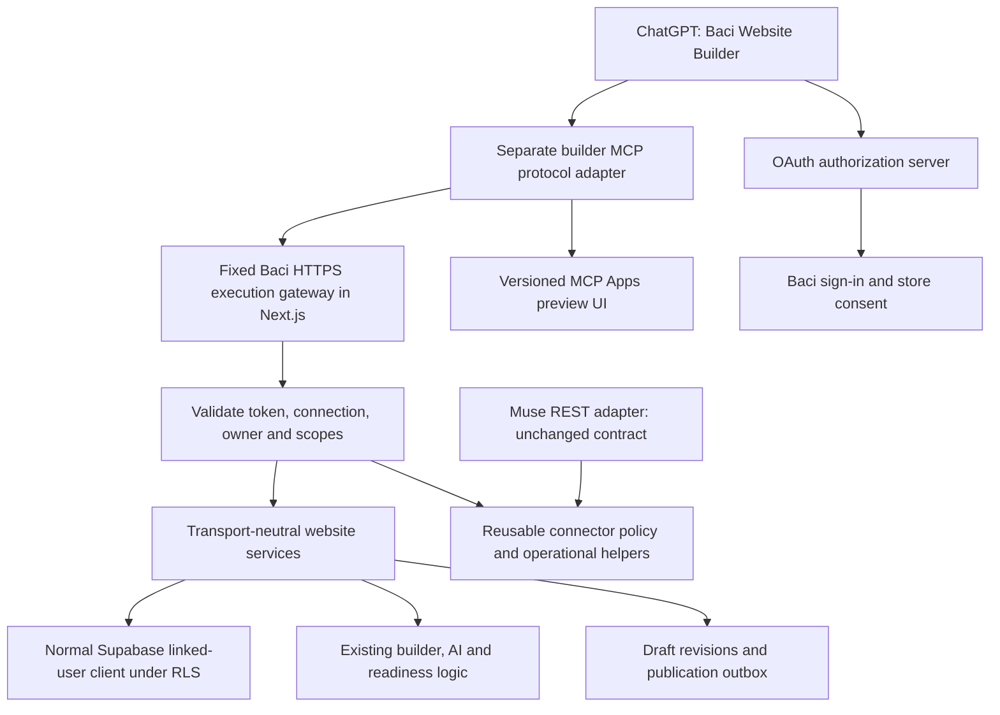

# Baci ChatGPT Store Builder — Design and Scope

**Date:** 20 October 2026

**Status:** Proposed implementation design with local Task 0 feasibility implemented and verified. Production activation, credentials, deployment and both submissions remain unchanged.

**Task 0 execution, 21 October 2026:** The [acceptance report](../../connectors/evidence/builder-runtime-preview-acceptance.md) supersedes the historical unexecuted-gate notes below. Certified preview scope is explicit `template_id: puck`, renderer `baci-home-six-v1`, and its six supported blocks. Existing unversioned layouts are not certified. Later tasks remain unstarted.

**Code baseline inspected:** `270fe355d8a78ddb685e3e490fcf6652fe89910e` on `origin/main`.

**Rereview:** Revised against the same code baseline on 20 October 2026. See the [finding disposition](../reviews/2026-10-20-baci-chatgpt-store-builder-rereview.md). Provider and preview feasibility gates remain unexecuted.

**Second rereview:** [Additional boundary and lifecycle corrections](../reviews/2026-10-20-baci-chatgpt-store-builder-rereview-2.md). The changes below remain design requirements, not completed runtime proofs.

**Third rereview:** [Page-consumer and confirmation corrections](../reviews/2026-10-20-baci-chatgpt-store-builder-rereview-3.md). The first release explicitly supports homepage customization; runtime gates remain unexecuted.

**Fourth rereview:** [Draft storage privacy and compatibility](../reviews/2026-10-20-baci-chatgpt-store-builder-rereview-4.md). A raw Data API privacy and legacy-consumer proof is now part of Task 0; current production policies were not queried.

**Fifth rereview:** [Committed retry ordering](../reviews/2026-10-20-baci-chatgpt-store-builder-rereview-5.md). Receipt reconciliation and approval for a new publication have separate validation order.

**Sixth rereview:** [Publication field scope](../reviews/2026-10-21-baci-chatgpt-store-builder-rereview-6.md), 21 October 2026. V1 homepage publication preserves both live and pending SEO/settings values rather than promoting them through the native broad publisher.

**Seventh rereview:** [Convergence and remaining proof gates](../reviews/2026-10-21-baci-chatgpt-store-builder-rereview-7.md), 21 October 2026. No new actionable planning findings; Task 0 and all runtime acceptance gates remain unexecuted.

## 1. Product decision

Build a separate **Baci Website Builder** ChatGPT plugin for merchants. A person connects their Baci account, creates a private website draft, describes edits in chat, previews the actual Baci design, and explicitly requests publication. Existing merchants can edit their current site without changing its live version until publication.

Reuse the Muse connector's authorization, grant, audit, rate-limit, and error-handling patterns, plus Baci's existing builder services. Keep Muse's REST/OpenAPI transport working. Introduce MCP as another adapter over common Baci services; do not replace the Muse API.

**Both existing submissions are protected:** do not edit, cancel, resubmit, refresh tools on, or deploy changes to the submitted Ogabassey app or Baci Muse integration as part of this project. A future Baci ChatGPT plugin has its own identity, endpoint, credentials, package, deployment, and release decision.

## 2. Groundwork recovered

The source search covered the main checkout, registered task worktrees, and relevant local branches. These are different kinds of evidence:

| Evidence | What is reusable | What is not established |
| --- | --- | --- |
| Historical July Store Builder planning notes | Draft-first lifecycle; semantic tools; OAuth provider acceptance gate; explicit publication | The referenced `2026-07-17-baci-chatgpt-store-builder.md` file was not located in the checked worktrees or reachable path history. Do not claim its implementation exists. |
| `codex/storefront-ai-r3-plan`, commit `edad4f48ccf3eb824ecf5d90dd8c5ed6a49a35fe` | August roadmap explicitly assigns **A1: domain service + OAuth**, **A2: Builder MCP + handoff**, and A3 host conformance | Branch documents are design inputs, not proof that those phases shipped. Do not cherry-pick unfinished foundation work wholesale. |
| Muse R0 worktree `.worktrees/baci-connector-r0` and production connector source | Tenant/grant checks, scoped selectors, revocation, audit, rate limits, four read-only API tools | No merchant builder MCP, ChatGPT OAuth flow, or production write authority follows from Muse's four read-only tools. |
| Current main: builder routes and AI edit pipeline | Load/save/publish, compare-and-swap on existing rows, capability validation and generation logic | Existing storefront job runner constructs a service-role client; it is not an authorized job executor for this plugin. The current preview also uses placeholder products/identity and imports the editor configuration. |
| Current main: Ogabassey MCP Apps widget | SDK v2 transport and standard MCP Apps bridge/build patterns | Buyer identity, its merchant constant, guest cart, review package, and legacy review resource are outside this project. |

The August documents are recoverable from **local Git history** with the following commands; GitHub did not resolve this commit during verification, so do not present it as a published source:

```sh
git show edad4f48ccf3eb824ecf5d90dd8c5ed6a49a35fe:docs/superpowers/plans/2026-08-18-baci-pagespec-commerce-runtime-agent-platform.md
git show edad4f48ccf3eb824ecf5d90dd8c5ed6a49a35fe:docs/superpowers/plans/2026-08-18-baci-storefront-ai-implementation-handoff.md
```

Their larger PageSpec/CommerceRuntime program is not a prerequisite rewrite for this MVP: use the validated builder contracts currently on main. If a needed capability exists only on an unmerged branch, implement the smallest reviewed adapter or defer that capability explicitly.

### Current source map

| Responsibility | Existing source, relative to repository root |
| --- | --- |
| Muse grant, tenant and permission policy | `apps/web/src/lib/connector/{grant,authorize,owner-access,connection,approval-proof}.ts` |
| Muse transport and operational controls | `apps/web/tools/connector-gateway/{server,tool-request,rate-limit,audit,openapi}.ts` |
| Existing connector credential trust boundary | `docs/adr/003-connector-gateway-database-access.md` |
| Normal linked-user Supabase access | `apps/web/src/lib/supabase/{server,mobile-auth}.ts` |
| Merchant identity/permissions | `apps/web/src/lib/get-merchant-for-api-request.ts` |
| Builder load/save/page publication | `apps/web/src/app/api/builder/{route,builder-request-context,builder-load-payload,builder-draft-mutations}.ts` |
| Curated homepage creation | `apps/web/src/lib/storefront-defaults/provision-curated-homepage.ts` |
| Merchant onboarding | `apps/web/src/app/(platform)/onboarding/{submit-onboarding-workflow,upsert-onboarding-merchant,ensure-onboarding-domain}.ts` |
| AI edits and validation | `apps/web/src/app/api/builder/ai-edit/handle-builder-ai-edit-request.ts`; `apps/web/src/lib/builder-ai/`; `packages/shared/src/contracts/builder-ai-edit/` |
| Existing job/computation reference | `apps/web/src/app/api/ai-jobs/`; `apps/web/src/lib/ai-storefront/process-storefront-layout-job.ts`; inspect service-role runner separately and do not reuse its authority |
| Actual preview rendering | `apps/web/src/components/storefront/render-builder-config.tsx`; `apps/web/src/app/(preview)/template-preview/builder-preview/` |
| Whole-store launch checks/public visibility | `apps/web/src/lib/store-readiness/`; `apps/web/src/app/api/merchant/publish/route.ts` |
| Public cache eviction | `apps/web/src/lib/storefront-publication-cache-eviction.ts` |

Current `saveBuilderDraft` and `publishBuilderDraft` already use an `updated_at` comparison on existing-row updates. Preserve those protections. Extend them for a coherent website revision and atomic history/publication; do not describe CAS as entirely absent. Current homepage provisioning initializes `published_config` and `is_published`; do not call it unchanged for a ChatGPT draft. The inspected migration baseline also permits public SELECT on a published `page_configs` row while that same row contains `draft_*` columns. Private preview therefore requires a database storage/access correction, not just a narrower MCP query.

## 3. First release and boundaries

### Included

- Baci sign-in/sign-up in a trusted browser during connection; never collect passwords, OTPs, tokens, KYC documents, or bank details in chat.
- Owner accounts first. Current schema enforces `merchants_user_id_key UNIQUE (user_id)` and onboarding expects zero or one owned merchant. Preserve that rule: the list returns zero or one consented owned store. Do not turn this plugin into a multi-store account migration. Staff access is denied in this release rather than inventing new permissions.
- Complete an owned, incomplete onboarding placeholder without creating a duplicate merchant. New stores remain unpublished.
- Create or edit the Puck homepage (`pageSlug: 'home'`), including copy, layout and theme styling, through Baci's validated component capabilities. Other storefront routes remain available through Baci; this release does not customize them through chat. Preserve current published SEO/global store/setup settings and their separately pending private drafts. Homepage publication does not promote those pending fields. An established slug is immutable in these tools.
- V1 creation uses explicit `template_id: 'puck'`. Existing stores are editable/publishable only when their template and actual public config consumer are in the proven capability manifest. Do not silently switch a registry/custom template to Puck or report an unused config as a website edit. Return `UNSUPPORTED_TEMPLATE` and the Baci editor link when that consumer is not supported.
- Describe changes in natural language; use existing Baci AI generation and validation. Persist generated changes only after version validation.
- Inline preview, optional negotiated fullscreen, mobile/desktop width controls, clear draft/live status, and a public URL only after verified publication.
- Owner-approved publication of the exact previewed revision; retain a history record and durable recovery state.
- Revocation and reconnect, job status, idempotent retries, typed conflict/error messages, and audit events.

### Deferred

Arbitrary executable code or raw Puck JSON from the model; domain purchase/DNS transfers; changing an established store slug; billing, payouts, payment-provider setup, orders, refunds, customer data, buyer carts; bulk catalog writes; general staff delegation; multiple owned stores per account; SEO/global-settings editing; secondary-page creation/editing/publication; arbitrary PageSpec/CommerceRuntime rewrites; a second host certification; changing either current submission. Current `published_seo` persistence alone does not demonstrate a storefront metadata consumer; do not advertise SEO edits until that separate producer-to-public-output path is implemented and tested.

**Publication prerequisites remain real:** current Baci readiness includes a published product, configured payment method, store URL, country and contact information, plus KYC where required. A new user can build and preview immediately, but must complete missing commercial setup in Baci before selling publicly. Return specific missing items with trusted dashboard links. Do not bypass these rules or imply this plugin performs payment/KYC setup. General non-commerce brochure-site publication would be a separate product/policy decision.

## 4. Architecture



Deploy the new MCP/auth processes separately from the Muse gateway and buyer MCP. Proposed names `mcp.usebaci.com/builder/mcp` and `auth.usebaci.com` are **design choices, not provisioned endpoints**. Confirm host ownership, reserved slugs and TLS before use. Keep all implementation flags off by default until release gates pass.

**Runtime boundary:** the standalone MCP process handles protocol, static resources and fixed-destination HTTPS calls. It does not import Next.js request/cache helpers or hold upstream Supabase credentials. Add a Baci web execution route at `/api/integrations/chatgpt/builder/[tool]` in the Next.js Node runtime; it authenticates the original audience-bound builder token and resolves the linked-user RLS client before calling domain services. This gateway is an execution component of the same Baci protected resource, not a generic forwarding proxy. Permit only the eight tool names, a configured Baci origin, bounded responses and no redirects. Never forward a token to a URL supplied by a tool argument or to a third-party service.

The Baci confirmation page and publication cache eviction run inside the Next.js application. Existing `next/cache`, `after()` and server-only helpers remain there. A website deployment for these new routes is a separate required release step; deploying the MCP adapter alone cannot deliver this feature. The provider spike must prove this gateway/resource boundary. Task 0 must prove an editor-free widget bundle plus the private-draft/public-read storage boundary and legacy compatibility before feature work proceeds.

### Authentication and authority

Use OAuth authorization code + PKCE S256, protected-resource and authorization-server metadata, exact issuer/audience/resource binding, and live connection revocation. Prefer CIMD where the selected provider passes current ChatGPT interoperability tests; retain a deliberately configured predefined-client fallback, not unrestricted registration. Register the exact callback supplied by Platform; do not hard-code an assumed callback URL.

Evaluate maintained `oidc-provider` in a mandatory isolated spike. Its documentation lists PKCE, resource indicators and experimental CIMD support; that is not acceptance evidence for Baci's configuration. Pin the tested release and prove durable storage, refresh rotation, revocation, exact redirects and restart behavior before proceeding. If it fails, produce a provider-selection ADR. Do not hand-roll OAuth or pass ordinary Supabase user JWTs to ChatGPT as a shortcut.

ChatGPT receives only an audience-bound Baci builder token. Where a normal Supabase user session is needed, keep the user's refresh/access credentials encrypted on the backend and renew them under a distributed per-upstream-session lock. Validate the upstream user with `auth.getUser()` before queries. Reuse the normal bearer-client behavior in `mobile-auth.ts` through a focused server-side factory; never construct caller-selected JWT claims, use a service-role client, or extend Muse's C-prime database credential to these writes. The vault is trusted infrastructure with access to linked-user authority; do not claim its compromise is confined to builder scopes. If a lost refresh result cannot be safely reconciled under the provider's tested rules, require reconnect rather than rolling credentials back or signing out unrelated sessions.

**Obtain a dedicated upstream grant; do not copy the browser's refresh token.** The provider acceptance spike must prove a server-side OAuth authorization-code/PKCE exchange from the Baci broker to Supabase's OAuth server using a predefined Baci broker client and a maintained OAuth client library. Keep this inner transaction's state, nonce, PKCE verifier, issuer/client audience and callback distinct from the outer ChatGPT→Baci transaction. Exchange the upstream code server-side and vault that grant's tokens; the browser's existing Baci session may authenticate the consent screen but must not become a shared refresh-token family. Validate stable upstream `sub` against `auth.getUser()`, never merge accounts by email.

Run concurrent browser and broker refreshes, two linked connections, local disconnect and reauthorization through this exact flow. Prove that broker refresh/disconnect does not rotate or terminate the browser's session or another connection. A per-user lock in the broker cannot coordinate a browser refreshing the same token family. If the project's upstream OAuth configuration cannot produce the required independently renewable/revocable grant, record NO-GO and choose another supported linking design; do not use admin token minting or browser-token capture. Outer `offline_access` consent and upstream token lifetimes/scopes must follow each provider's actual metadata, not a guessed shared scope list. Enabling upstream OAuth or registering a real broker client requires its own owner-approved configuration step.

Current [Supabase token-security guidance](https://supabase.com/docs/guides/auth/oauth-server/token-security) explicitly distinguishes OIDC scopes from database permission and shows OAuth tokens with the normal authenticated database audience. Using Supabase for Baci sign-in remains appropriate; directly giving its existing user-data token to ChatGPT is not accepted as a scoped builder design. A native Supabase OAuth alternative must pass the same resource/scope and direct-Data-API isolation tests before replacing this design, without broad changes to existing app policies.

Use `storefront.read`, `storefront.write`, `storefront.publish`; require read alongside write/publish. Persist each connection's owner, consented store IDs, create-store permission, scope set, expiry and revocation/version. Every operation intersects token scopes, live grant and live ownership. An identifier is a selector, never authority. A new-store capability must be explicitly consented and is usable only for provisioning the authenticated owner's store/placeholder.

Use **one canonical authorization row per connection**, shared by OAuth revocation/refresh-reuse handling, Baci disconnect and transactional mutation checks. Keep it in the private authorization schema; unlike encrypted vault/provider-token tables, expose only its non-secret owner metadata through a narrowly granted RLS/security-invoker interface. SECURITY INVOKER business RPCs need explicit privileges to lock/read that same row, with policies preserving owner and existing browser permissions. The provider storage role may update this authorization metadata and its own private token records, but has no commerce-table privileges or authenticated-role membership. Do not maintain an independently stale public “active connection” copy. Acknowledging revocation must commit the canonical row change; concurrent mutations serialize against it. Clearing provider tokens alone or checking a revoked state only at HTTP entry is insufficient.

Each tool declares `securitySchemes: [{ type: 'oauth2', scopes: [...] }]` with its exact required scopes. Tool-level authentication failures include `isError: true` and `_meta['mcp/www_authenticate']`; transport-level failures also preserve the appropriate `WWW-Authenticate` challenge. Test both discovery metadata and runtime challenges, because metadata alone does not trigger ChatGPT account linking. Public initialization/discovery may return static schemas but no business data.

Provisioning must attach the newly created/completed merchant to the connection in the same transaction. Consent to create the owner's single store already covers this binding: materializing that previously empty target does not widen scope or change `grantVersion`. The same token must work for the next status/edit call. Any subsequent change to actual permissions requires versioned reauthorization. A create request against an established store returns `STORE_ALREADY_EXISTS`, with no alteration or implicit consent to that store.

Every new mutation—including queue insertion, lease claim, candidate completion, draft application and publish-intent creation/confirmation—must recheck the live connection row **inside its business transaction**. Serialize against revocation/version changes; require current expiry, operation scope, grant version, owner and target binding before reading an idempotent result or writing an effect. Request-entry authorization alone is insufficient across a long provider call. A mutation already linearized before revocation may finish; no mutation may linearize after revocation using a previously resolved context. Candidate completion rechecks after generation and loses the race if its grant/lease changed. Legacy browser mutations retain their existing authorization rather than requiring a ChatGPT connection.

## 5. Tool and service contracts

Expose eight focused tools, all with strict Zod input and output schemas. No tool accepts a raw config, user ID, role, approval boolean or credentials. Normal results have useful text plus `structuredContent`; only the preview tool attaches `_meta.ui.resourceUri`.

| Tool | Main input | Result | Scope / annotations |
| --- | --- | --- | --- |
| `list_storefronts` | Cursor, optional page size | Consented owned stores; onboarding state | read; read-only, closed-world |
| `get_storefront_status` | `storefrontId` | Draft/live revision, pending operations, readiness | read; read-only, closed-world |
| `create_storefront_draft` | Business name/type/country, desired slug, brand brief, idempotency key | Unpublished store and initial revision | write + explicit create consent; mutation, idempotent, closed-world |
| `update_storefront_draft` | Store/page, expected revision, instructions, idempotency key | Queued edit operation | write; mutation, idempotent, closed-world |
| `get_storefront_operation` | Store and operation ID | Pending/ready/failed/conflict status and safe summary | read; read-only, closed-world |
| `apply_storefront_operation` | Store, operation ID, expected revision, idempotency key | New saved draft revision and change summary | write; mutation, idempotent, closed-world |
| `preview_storefront` | Store/page and exact revision | Validated read-only rendering projection and readiness | read; read-only, closed-world; UI resource |
| `publish_storefront` | Store, exact revision, idempotency key | Approval required, blocked, pending verification, or live | publish; mutation, destructive, idempotent, open-world |

Annotations are accurate host hints, not authorization or confirmation evidence. Mark mutation `readOnlyHint: false`; draft mutations `destructiveHint: false`; public publication `destructiveHint: true`. Idempotent means the same key **and canonical effect** are replayable within the defined retry window, not permission to publish without approval.

### Shared interfaces

Define these in web-owned schemas/types; do not introduce a second cross-app shared contract unless another app actually consumes it:

```ts
type BuilderPageSlug = 'home'; // Only the proven Puck homepage consumer in v1.
type DraftVersion = string; // Opaque revision token, not a credential.
type PublishedVersion = string; // Public snapshot version; independent of a plugin receipt.
type BuilderScope = 'storefront.read' | 'storefront.write' | 'storefront.publish';
type BuilderOperationStatus = 'pending' | 'running' | 'ready' | 'applied' | 'failed' | 'conflict';
type PublicationStatus = 'approval_required' | 'blocked' | 'verifying' | 'live' | 'superseded';
interface BuilderIdentity {
  actorUserId: string;
  connectionId: string;
  grantVersion: number;
  scopes: ReadonlySet<BuilderScope>;
  allowedMerchantIds: readonly string[];
  allowCreateStore: boolean;
}
interface BuilderContext {
  identity: BuilderIdentity;
  merchantId: string;
  supabase: SupabaseClient<Database>; // Validated linked-user session, RLS enforced.
}
interface BuilderPublishBinding {
  actorUserId: string;
  connectionId: string;
  grantVersion: number;
  storefrontId: string;
  draftVersion: DraftVersion;
  destinationUrl: string; // Server-derived, not a model-selected URL.
  pageSlugs: readonly BuilderPageSlug[]; // Exactly ['home'] in a v1 publish intent.
  policyNamespace: 'baci.website-builder';
  policyVersion: number;
}
interface BuilderPublishIntent extends BuilderPublishBinding {
  intentId: string;
  effectDigest: string;
  nonce: string;
  issuedAt: string;
  expiresAt: string;
}
interface BuilderPublishExecution extends BuilderPublishBinding {
  effectDigest: string; // Recomputed from the authoritative snapshot.
  nonceConsumed: boolean;
  approverAuthorized: boolean;
  now?: Date;
}
type BuilderApprovalVerificationResult =
  | { ok: true; nonce: string }
  | { ok: false; code: 'APPROVAL_EXPIRED' | 'APPROVAL_ALREADY_USED'
      | 'APPROVAL_MISMATCH' | 'CONNECTION_REVOKED' | 'INSUFFICIENT_SCOPE' };
```

Use schema-inferred `CreateDraftInput`, `UpdateDraftInput`, `ApplyOperationInput`, `PreviewInput`, `PublishInput` and result DTOs throughout the services and registry. Version tokens represent the website's draft revision, including relevant branding/SEO and the selected pages. Require them for edits, application and publication. A conflict returns `STALE_DRAFT`, current revision and a refresh instruction; never automatically overwrite a changed draft.

Use these exact wire field names; Task 2 supplies strict runtime validation and schema-inferred TypeScript types:

| Input type | Fields |
| --- | --- |
| `ListInput` | `cursor?: string`, `pageSize?: number` (default 20) |
| `StatusInput` | `storefrontId: string` |
| `CreateDraftInput` | `businessName: string`, `businessType: string`, `country: string`, `requestedSlug: string`, `brandBrief?: string`, `idempotencyKey: string` |
| `UpdateDraftInput` | `storefrontId: string`, `pageSlug: BuilderPageSlug`, `expectedVersion: DraftVersion`, `instructions: string`, `idempotencyKey: string` |
| `OperationInput` | `storefrontId: string`, `operationId: string` |
| `ApplyOperationInput` | `storefrontId: string`, `operationId: string`, `expectedVersion: DraftVersion`, `idempotencyKey: string` |
| `PreviewInput` | `storefrontId: string`, `pageSlug: BuilderPageSlug`, `expectedVersion: DraftVersion` |
| `PublishInput` | `storefrontId: string`, `expectedVersion: DraftVersion`, `idempotencyKey: string` |

Storefront/operation/connection IDs use UUID validation; onboarding fields use the existing Baci schemas/allowlists. The new adapter narrows `pageSlug` to the literal `'home'`; the current general builder schema's arbitrary string does not prove public support. Reject unsupported pages before queueing or AI work with `UNSUPPORTED_PAGE`. Limit a brand brief to 4,000 characters and an idempotency key to a UUID. Reject unsafe/unavailable requested slugs without mutating existing records. `DraftResult` returns `storefrontId`, `version`, `changedPages` and `status: 'draft'`; `QueuedEditResult` returns `storefrontId`, `operationId`, `sourceVersion` and `status: 'pending'`; `OperationResult` returns those identifiers plus its operation status and safe summary. `StorefrontStatusResult` returns `storefrontId`, `draftVersion`, nullable `publishedVersion`, `isPublished`, nullable latest receipt, launch blockers, pending operation IDs, `supportedPageSlugs: ['home']` and supported edit/preview/publish capabilities. `StorefrontListResult` returns those stores' ID/name/slug/onboarding summaries plus nullable `nextCursor`. `PreviewResult` adds `pageSlug`, normalized render projection and readiness to the exact draft identity. `PublishResult` contains `storefrontId`, `version` (the approved source draft), its discriminated status and only matching fields: `intentId`/`approvalUrl` for approval; `missingItems` for blocked; `receiptId`/`publishedVersion`/optional `deliveryBlockedReason` for verifying; `receiptId`/`publishedVersion`/`publicUrl`/`verifiedAt` for live; and `receiptId`/`publishedVersion`/`currentPublishedVersion` plus optional `supersededByReceiptId` for superseded. A later native Baci publish/unpublish may have no plugin receipt, so the newer receipt ID cannot be required.

Limits for this adapter: 64 KiB request body, instructions 1–4,000 characters, page size 1–20, and a seven-day idempotency result retention. Reuse stricter existing component/AI complexity limits. Rate limits are per linked user/connection as well as ingress IP; the existing builder AI quota remains in force.

Tool data getters are read-only: `get_storefront_status` includes the latest authorized publication receipt/delivery state, and `get_storefront_operation` never starts generation or applies results. Replaying `publish_storefront` resolves the existing intent/receipt's **current** state; it does not return a permanently cached `approval_required` or `verifying` snapshot. Its canonical digest binds store, revision, changed-page set and destination independently of the retry key.

## 6. Persistence, preview and publication

### Drafts and jobs

Add append-only migrations for private draft storage, the safe public-read compatibility boundary, connection records, website revisions, operation/idempotency records, publication intents and an outbox. Enable RLS, index foreign keys, use explicit column projections and SECURITY INVOKER business RPCs. Provider/vault storage uses a private schema and narrowly granted auth-storage role with no commerce-table or authenticated-role membership. Grant the normal user's business RPCs only the necessary access to the canonical non-secret connection authorization row under RLS; encrypted tokens and provider secrets remain inaccessible. This role/interface is not a path for merchant data queries or a replacement for merchant authorization.

**Separate private drafts from public rows.** The baseline grants table access to anon/authenticated, and `20260612061125_harden_access_helper_policies.sql` still permits published `page_configs` rows to both roles. RLS filters rows, not draft columns within an allowed row. Store unpublished config/SEO/settings in a separate owner/staff-authorized `builder_page_drafts` table; keep operation candidates, history and preview snapshots private too. Public `page_configs` compatibility reads may expose only approved published data, never a private `draft_*` copy. Explicit `.select('published_config')` in the current client does not prevent a caller selecting draft columns directly.

Task 0 must prototype the exact split, grants, authorized browser/native-AI adapters and backfill/compatibility sequence before Task 4 adopts it. Preserve the existing published-config query contract used by Puck and installed mobile storefront clients, plus normal owner/staff builder DTOs, CAS and readiness behavior. Include every draft reader/writer, not only MCP. Do not solve compatibility with a privileged view, new service-role private-draft access or public draft copies. If an existing native AI/legacy reader cannot use the accepted boundary, record the prerequisite/refactor and NO-GO; do not assume it works.

Roll out additively with feature flags off: introduce private storage/adapters, backfill with concurrent-write reconciliation, deploy/prove compatible readers/writers, then contract public access/data only after the acceptance suite passes. Test fresh install, upgrade, unpublish/delete visibility and application rollback without restoring draft exposure. Existing mobile/public clients must still read approved published config as both guests and signed-in customers. No new feature is enabled during a compatibility window that still exposes private copies. This is a required migration design/proof, not an authorized production change.

Create/complete a merchant, attach the connection target and create the initial private draft atomically. Preserve existing owner uniqueness and slug constraints; reject reserved hostnames and collisions. Do not insert an extra merchant on a repeated connection or overwrite an established slug. Creation uses the pre-consented account capability rather than demanding a merchant-scoped context before that merchant exists.

The same transaction must reserve the canonical `${slug}.${configuredRootDomain}` entry in `domains`, following `ensureOnboardingDomain` semantics: normalized domain, `domain_type: 'subdomain'`, active status and preservation of an existing primary domain. The root domain comes only from server configuration. Reuse its ownership/conflict decisions inside the transaction instead of calling the current multi-request helper after commit. A domain collision rolls back merchant/draft/connection changes and returns a safe unavailable-slug result; never reveal the other owner or take over the domain. An established placeholder slug cannot be replaced by a different requested slug. Staging must verify wildcard host resolution reaches this merchant while its unpublished site remains private. No paid domain, new DNS operation or custom-domain transfer is part of the tool.

Reuse the current provider chain, normalizer and capability validator, **not** the existing global `ai_jobs` dispatcher. `src/scripts/process-ai-storefront-jobs.ts` constructs a service-role client. Use a separate `builder_edit_operations` table under linked-user RLS so the existing dispatcher cannot claim these jobs. A builder runner enumerates bounded connection identifiers from its private auth storage, resolves each linked-user client, and queries/claims only that connection's pending operations. It has no global application-table credential or authenticated-role database membership. The runner invokes a fixed Baci Node-runtime job endpoint with the server-held linked-user credential; the endpoint rechecks the operation's live connection/owner, obtains the operation solely from RLS-authorized storage and runs the existing AI core. No model can supply a job payload, user identity or upstream token to this endpoint.

Generation is restartable through a lease/CAS state machine: `pending → running → ready → applied`, with a five-minute lease, at most three generation attempts and 60/120-second retry delays for transient failures. Existing provider timeouts and user AI quotas still apply; retries consume that same quota. Recover expired leases; reject completion from an old lease owner. Permission, revocation, invalid-output and stale-source failures are terminal `failed`/`conflict` outcomes, not automatic retries. Recheck revocation before starting and before saving a candidate. The generator produces a candidate, not a live-site mutation. A ready operation stores the source revision and server-generated digest. `apply_storefront_operation` revalidates and commits it under RLS/CAS. Revocation or a stale source revision prevents applying a late job. An expired upstream session yields a reconnect-required state, not a privileged fallback. Polling performs no job or draft writes.

Database revision maintenance must cover every relevant writer, not just the new service. Inventory existing builder POST/PUT, `apply_ai_storefront_draft`, onboarding, supported staff/browser writes and direct RLS mutations. Maintain a per-store draft revision with database triggers/locking for private draft and published-page insert/update/delete and any inputs actually included in the draft snapshot. Use one documented lock order for browser writes, MCP commits and publication. Do not broaden existing staff permissions or make their legitimate browser writes fail under an owner-only revision policy. V1 publishes exactly the approved homepage snapshot, with intent `pageSlugs: ['home']`; it must not also publish unrelated pending secondary drafts. Preserve their draft and published values and existing About/Contact/catalog routes. Keep whole-website revision invalidation for legacy secondary-page writes so an old approval still fails safely. Current published settings/SEO and their pending private drafts are preserved separately; history records the old published state without promoting pending values or accepting new edits from this plugin.

Prove the lock graph before accepting the migration: row-level triggers may run after the writer already holds a page lock, so saying “lock merchant first” in the new service is not sufficient. Deterministic tests must interleave legacy page writes, homepage publication, connection revocation and trigger revision updates, with bounded lock/statement timeouts and safe conflict/serialization recovery. Do not apply a trigger design that strands or deadlocks ordinary browser/staff writes.

Use a canonical effect digest with a versioned format. The idempotency ledger is scoped to actor, connection, tool and key; the same key with different inputs returns `IDEMPOTENCY_CONFLICT`. Concurrent duplicate requests produce one effect. Check current authorization before replaying a saved result. After the retention window, reconcile state instead of blindly retrying an old mutation.

For mutation evidence, append a redacted audit event in the same database transaction as create, draft application and publication; if that insert fails, roll back the mutation. Record actor/connection, operation, resource, before/after revision, digest and outcome, not prompts/config bodies or secrets. Muse's request audit intentionally drops events under saturation; reuse its redaction pattern only. Best-effort request telemetry is not the durable mutation or approval ledger.

### Private preview

Serve a new resource such as `ui://baci-builder/preview-v1.html` with `text/html;profile=mcp-app`, using the existing standard-first bridge pattern. Negotiate `availableDisplayModes: ['inline', 'fullscreen']`. Use `@modelcontextprotocol/ext-apps`, host theme/size information and safe error/height handling. No new legacy resource is needed for this new plugin.

Extract reusable presentational renderer components from Baci rather than importing the monolithic editor `config.tsx` into a widget. It currently includes `next/image`, `next/link`, editor fields and live component dependencies; `RenderBuilderConfig` also replaces merchant/product data with preview fixtures. That file is evidence of safety patterns, not proof of a portable or exact widget. First prove a shared editor-free renderer for Header, Hero, Text, Button, Footer and ProductGrid, reusing the production presentation and theme rules. Do not silently replace Next APIs with semantically different stubs.

Keep cart, checkout, analytics and navigation effects inert. For ProductGrid, project only authorized published catalog display fields for the linked merchant; use real identity/assets and clearly mark an empty/demo catalog rather than presenting sample prices as live. The widget renders the authorized snapshot from tool data; it contains no auth tokens, signed bearer preview URL, editable raw HTML, or customer information. `_meta` is not a secret store or access-control boundary. Static resource caching must never cache tenant data. The new widget is an explicit pnpm workspace package with its own build/typecheck scripts; the current workspace includes only the old buyer widget.

Catalog display is a timestamped read snapshot, not a price reservation or product mutation. The approved website effect freezes layout/theme/copy; existing catalog changes remain dynamic and launch readiness is rechecked at publication. Do not include secrets or private draft product fields in that projection.

The current Puck public loader selects only `page_slug = 'home'`; About uses merchant `about_page`/`pages.about`, and Contact uses merchant/support fields. Therefore v1's capability manifest and widget label explicitly cover only the homepage. Adding another editable page requires a separate schema/service/public-route/preview proof; saving an arbitrary `page_configs` slug is insufficient.

Validate the same normalized config with the same capability registry before preview, save and publish. Test actual component parity at 375, 768 and 1200 CSS pixels. Unsupported components get an explicit preview-unavailable message and an authenticated Baci editor link; never silently substitute a different design. First-release generation must emit only the component set whose widget parity is proven.

The feasibility gate must produce an editor-free self-contained HTML bundle within 3 MiB raw/1 MiB gzip, prove the six supported blocks and inherited theme/CSS in both web and widget renders, and record the exact supported capability manifest. If it fails, revise the preview architecture before feature implementation; do not call a screenshot or approximate card the requested live preview.

### Explicit publication

Publishing changes the public website and needs an effect-bound approval. A model's `confirm: true` is insufficient. Until a host supplies a Baci-verifiable approval receipt, `publish_storefront` creates a one-time intent and returns a trusted Baci confirmation URL. The widget can explain the change and open that page; the owner confirms while signed into Baci. This is an intentional browser confirmation step, even though building and previewing happen in ChatGPT.

The confirmation page shows store identity, actual destination, the homepage change, exact revision, launch blockers and an authoritative preview of that intent-bound homepage through the shared inert renderer. Define `PublishConfirmationView` with `intentId`, `storefrontId`, `draftVersion`, server-derived `destinationUrl`, `pageSlugs: ['home']`, `preview: PreviewResult` and `missingItems: readonly string[]`; load it with `loadPublishConfirmation(ownerClient, intentId)`. Never display the latest draft while approving an older snapshot. A changed draft requires a new intent for an uncommitted effect; unsupported snapshots fail closed and rendering errors leave confirmation unavailable without consuming the intent. This page supplies the preview when ChatGPT did not call the preview tool first. Do not trust a model/client “viewed” boolean or claim proof that a human examined it. Its authenticated, CSRF-protected POST atomically consumes the intent and publishes; MCP cannot approve the intent. Reuse Muse's generic `effectDigestOf` canonical hashing, but define a separate `BuilderPublishIntent`/`verifyBuilderPublishIntent` contract: its draft revision is the exact opaque string and its policy namespace is `baci.website-builder`. Muse's existing verifier accepts a numeric `resourceVersion` and fixes `CONNECTOR_POLICY_VERSION`; do not coerce an opaque revision to a number or reuse Muse's policy authority. Durable receipt/nonce enforcement still belongs in the business transaction. An intent expires after ten minutes and binds owner, connection, grant version, effect digest, draft revision, destination and builder policy version. Recheck live authorization/readiness immediately before commit.

One transaction reads the approved private homepage layout snapshot and writes its `page_configs.published_config`, necessary publication metadata/revisions, required store visibility, complete pre-publication layout/SEO/settings history, receipt and cache-eviction outbox. Its fixed field allowlist excludes `published_seo`, `published_store_settings` and `published_setup_settings`; retain those current published values and leave pending private SEO/settings untouched. The current `publishBuilderDraft` assigns all three from draft fields, so it cannot be called unchanged for this narrower effect. Keep the ordinary browser publisher's authorized scope unchanged. For a new store, prove null/default published side fields work through existing storefront fallbacks; report missing setup/readiness rather than promoting an unapproved pending draft. No model-selected field mask or implicit settings publication is allowed. A failed history write rolls back publication. For existing live stores retain current public content until this commit. Reuse the existing launch-readiness policy and public-alias eviction logic; page-level publication alone must not be reported as whole-store launch.

Database commit, cache eviction and live verification are distinct states. An eviction failure leaves `verifying`, not a false failure that invites a second publication. Retry the outbox step, reconcile the receipt and verify the expected `PublishedVersion` before returning `live`. Maintain that public version in the database for **all** effective published-state writers, including the existing browser publish/unpublish and AI/native paths—not just plugin publications. A newer native publication may have no plugin receipt. Return `superseded` with `currentPublishedVersion` and only an optional newer receipt ID, rather than marking the old revision live or retrying forever. Enforce a unique receipt for the same store/revision/effect/policy even when a retry mistakenly supplies a new idempotency key.

The public version marker must come from the same atomically selected published config/version DTO actually rendered, never a separate receipt or “latest version” lookup. The current Puck storefront loads config in the browser, so raw HTML/HTTP 200 is insufficient proof. Add `data-baci-published-version` at the public render commit and a read-only, bounded headless probe in the runner. It loads canonical pages without owner credentials, checks rendered version and representative changed content, and records no private drafts. Test native publish/unpublish overtaking both queued verification and a completed earlier receipt. The feasibility task must cover this client-rendered path and the safe public snapshot projection.

Use a least-authority delivery runner that obtains the existing linked-user session and reads/claims that owner's outbox under RLS; do not introduce a global service-role drain. If that session expires or is removed, preserve the outbox and expose an owner sign-in/retry action in Baci. The owner can resume already-committed delivery with a new normal session without reviving a revoked ChatGPT connection. Check connection authority for new mutations, but do not re-publish just to complete a committed receipt. The Next.js delivery endpoint derives trusted store aliases itself and can only evict/verify that receipt. Verify on the canonical Baci storefront hostname first; validate any custom verification target's HTTPS/public address and redirect policy to prevent SSRF. Never fetch an argument-selected verification URL or forward authorization headers to the public store.

Publishing twice with the same intent/key returns the same receipt and its current delivery state. In the business transaction, first authenticate/authorize the current caller and lock the canonical connection and matching request/effect record; verify the stored canonical input/intent binding. If that exact effect already committed for the authorized caller/connection, return its existing receipt's current delivery/supersession state before checking new-write approval expiry, consumed nonce, draft CAS or readiness. Those checks protect a new write and cannot turn a successfully committed retry into `APPROVAL_EXPIRED`, `APPROVAL_ALREADY_USED` or `STALE_DRAFT`. A changed canonical input with the same key remains `IDEMPOTENCY_CONFLICT`; a missing receipt must pass every new-write check. Concurrent duplicates re-read the receipt after acquiring the serialization lock. Expired/revoked/unauthorized callers remain denied before replay; owner sign-in delivery recovery keeps its separate authority path. Reconciliation never issues a new approval or publishes again. Rollback uses saved history through a separately approved action; do not silently unpublish on a verification timeout.

## 7. Delivery and acceptance

Implement the linked plan as reviewable slices: runtime/privacy/preview feasibility → OAuth acceptance → contracts/authorization → lifecycle persistence/services → MCP → private widget → publication → isolated staging and package preparation. No automatic submission, existing-app migration or production deployment follows from this document.

Success requires a real ChatGPT session to connect a new owner, create a private store, edit it, render the exact draft, complete publication approval, and open the verified public result. Repeat for an existing store while proving its live site stayed unchanged before publication. Negative cases must prove cross-tenant denial, revoked/expired connections, stale revisions, duplicate retries, blocked launch readiness, malformed model output and publication/cache recovery. Preserve both submission identities and payloads.

## 8. Current primary guidance

Checked 20 October 2026 using the OpenAI Developers documentation tools:

- [Plugin architecture](https://developers.openai.com/plugins/concepts/plugins): remote MCP tools with optional UI.
- [Authentication](https://developers.openai.com/plugins/build/auth): OAuth, metadata, PKCE, issuer/resource binding, CIMD and supported client registration.
- [MCP server](https://developers.openai.com/plugins/build/mcp-server): tool contracts, discovery, transport and metadata.
- [ChatGPT UI](https://developers.openai.com/plugins/build/chatgpt-ui): MCP Apps first, separate data processing from rendering, versioned resource URIs and CSP.
- [Submission and hosted updates](https://developers.openai.com/plugins/deploy/submission): new package review, MCP scans and compatibility with approved tool definitions.
- [oidc-provider primary repository](https://github.com/panva/node-oidc-provider): candidate provider capabilities; CIMD is experimental and must be configured/tested, not assumed.
- [Supabase column-level security](https://supabase.com/docs/guides/database/postgres/column-level-security): row policies do not hide draft columns; table-level grants override narrower column revocation.
- [Supabase token security](https://supabase.com/docs/guides/auth/oauth-server/token-security): OAuth scope and Data API/RLS authority are distinct.
- [Supabase OAuth flows](https://supabase.com/docs/guides/auth/oauth-server/oauth-flows) and [sessions](https://supabase.com/docs/guides/auth/sessions): upstream code/refresh exchange and refresh-family behavior must be proved independently of the browser's session.

The Supabase changelog was also checked. The announced [CBC cipher removal](https://supabase.com/changelog/cbc-tls-ciphers-deprecated) is a TLS compatibility check for the new runtime; use supported Node/OpenSSL rather than a cipher downgrade. The [PostgreSQL minor-release changes](https://supabase.com/changelog/postgres-15-19-17-11-breaking-changes) reinforce using current migration test images and modern authenticated encryption for the vault, not legacy pgcrypto PGP ciphers. No database upgrade or repair is authorized or required by this plan.

The inspected repo already declares `@modelcontextprotocol/server ^2.3.1`, `@modelcontextprotocol/node ^2.1.1`, widget `@modelcontextprotocol/ext-apps ^2.0.3`, React 19.2.3, Next.js 16.3.8 and pnpm 11.7.0. Reuse the locked compatible SDK family; do not downgrade to a v1 example or assert these are the latest registry releases. Verify maintained stable versions and security advisories during the provider/SDK acceptance task before changing dependencies.
